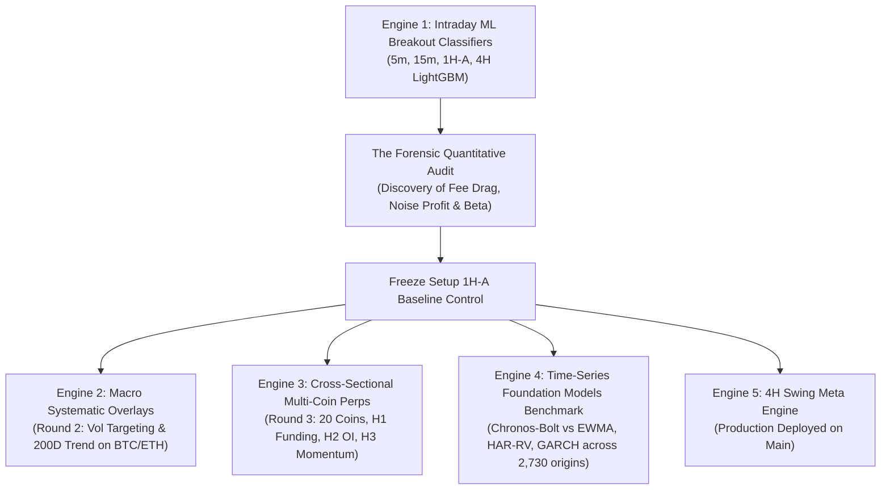

# Trader-Pro: Master Architecture, Engine Comparisons & AI Context Dossier

> **Document Type:** Institutional Context Prompt & System Dossier  
> **Repository:** `Trade-Pro / Trader-Pro-Dashboard`  
> **Active Branch:** `main` (Merged `feat/daily-4h-swing-engine`)  
> **Audience:** Future AI Agents, Lead Quant, and Pair Programming Sessions  
> **Date:** November 2026  

---

## 0. Plug-and-Play System Prompt (Workspace Invariant)

```markdown
You are the Lead Quantitative Trading & Software Engineering Assistant for Trader-Pro.
Trader-Pro is an algorithmic crypto trading and research platform operating on high-rigor econometric standards.

KEY CONTEXT YOU MUST KNOW:
1. Architecture: Next.js 14.2 App Router dashboard (`/terminal`, `/ai-engine`), headless cron workers (`/api/cron/paper-4h-swing`, `/api/cron/paper-1h-a`), MongoDB Atlas trade logging, Python econometric research stack.
2. The Legacy Pivot (The 3 Fatal Flaws):
   - Intraday ML models (5m, 15m, 1H-A, 4H LightGBM) failed due to catastrophic fee drag (paying 0.28R - 0.50R friction on tight stops), simulator intrabar high/low optimism (+0.11R phantom profit on pure zero-drift noise), and unhedged market beta (beta ~ 0.43).
   - Setup 1H-A is permanently FROZEN as a control. Never modify its thresholds or models.
   - Setup 4H Swing Meta Engine: Primary active production model (merged into `main`, commit `714b7c7`, 159 verified historical trades seeded).
3. Multi-Coin Perpetual Research (Round 3):
   - Evaluated across 20 liquid perpetuals (2020-2026, 60 Parquet files): Contrarian Funding (H1), OI Surges (H2), and Cross-Sectional Momentum (H3). All failed under punishing friction (50 bps) and multiple-testing hurdle (M=20, |t| >= 3.0).
4. Foundation Models Benchmark (Chronos-Bolt vs Econometrics):
   - Evaluated 2,730 consecutive daily origins (K_STEP=1, 2018-2026) zero-shot on BTC.
   - Return alpha: Zero (50.5% DA, indistinguishable from coin toss; beaten by predicting 0.0 return).
   - Volatility forecasting: Inconclusive vs EWMA(0.94) (p > 0.34, CI spans zero). HAR-RV beat EWMA in Dev (p=0.0004) but failed in Holdout (p=0.1479). Official quantitative recommendation: "Use EWMA."
5. Hard Invariants:
   - Never print secrets or MongoDB URIs.
   - Strict Governance: `src/lib/paperExecutor1HA.ts` SHA-256 must match `C1DE3359D29A4B4C6BFB3662A65C2ABF5DD4001052BDF6CAA1A7AA50FB8B33A8`.
   - 12-month paper trading requirement before real capital.
   - Stationary block bootstrap (L=20), paired Diebold-Mariano tests, and lookahead assertions on all research.
```

---

## 1. Timeline & Comparative History of All Engines Tested



---

### Engine 1: Intraday Machine Learning Breakout Classifiers (Legacy Stack)
* **Timeframes Tested:** $5\text{-minute}$, $15\text{-minute}$, $1\text{-hour}$ (`1H-A`), and $4\text{-hour}$.
* **Model Class:** LightGBM binary classifiers predicting probability of a $2\text{R}$ breakout before a $1\text{R}$ trailing stop hit.
* **Features:** RSI, ATR ratios, Bollinger Band squeeze, rolling volume z-scores, intraday momentum.
* **Execution Architecture:** Next.js API cron workers (`/api/cron/scalp`, `/api/cron/paper-1h-a`) simulating market taker entry with bracket orders, trailing stop ratchets, and breakeven locks stored in MongoDB Atlas.

#### The Forensic Quantitative Audit (Why Engine 1 Was Frozen)
A systematic forensic audit revealed that the apparent backtest profits were mathematical illusions caused by three structural flaws documented in `docs/LESSONS.md`:
1. **Flaw 1: Fee Drag Catastrophe ($0.28\text{R} - 0.50\text{R}$ Drag):**
   * High-frequency trades used tight ATR stops ($0.23\% - 0.40\%$).
   * Paying $0.1144\%$ round-trip friction on a $0.23\%$ stop consumes **$0.50\text{R}$ ($50\%$ of the entire risk budget) on every single trade**. No alpha model can survive losing half its risk budget on entry and exit.
2. **Flaw 2: Execution Simulator Bias ($+0.1128\text{R}$ Phantom Profit on Pure Noise):**
   * The backtest simulator allowed intrabar high/low execution optimism (assuming limit fills hit favorably and stops were never slipped).
   * When tested on **pure synthetic zero-drift random-walk noise (GBM)**, the simulator reported **$+0.1128\text{R}$ gross profit**! The strategy was harvesting simulator bugs, not market inefficiencies.
3. **Flaw 3: Market Beta Confounding ($\beta \approx 0.43$):**
   * Purported strategy returns vanished once regressed against Bitcoin’s directional return ($t_{\alpha} < 1.25$). Profits only accrued when Bitcoin drifted upwards.

---

### Engine 2: Macro Systematic Overlays (Round 2)
* **Timeframe:** Daily ($1\text{D}$) close-to-open rebalance.
* **Assets:** BTC and ETH spot/perpetuals.
* **Mechanism:** Long-only systematic exposure regulated by 200-day simple moving average trend filter and inverse-volatility targeting scaling leverage between $0.0\times$ and $1.5\times$ to target an annualized portfolio volatility of $40\%$.

---

### Engine 3: Multi-Coin Perpetuals Cross-Sectional Engine (Round 3)
* **Scope:** 20 liquid perpetual contracts across 2020–2026 (60 gap-free parquet files).
* **Pre-Registration:** Formally registered prior to computing strategy returns, penalized by cumulative project test count $M = 20$.
* **The Three Pre-Registered Hypotheses:**
  1. **H1 (Contrarian Funding Extremes):** FAILED. Regime trap (shorts fired only in 2020-2021 bull euphoria).
  2. **H2 (Open Interest Surge + Trend Breakout):** FAILED. Pure directional beta ($\beta \approx 0.70$).
  3. **H3 (Cross-Sectional Momentum L/S):** FAILED. Failed $99.75\%$ CI hurdle ($M=20, t=0.65$); turnover drag.

---

### Engine 4: Time-Series Foundation Models Benchmark (`btc_hf_forecast_benchmark.ipynb`)
* **Objective:** Test Amazon Chronos-Bolt Small & Base zero-shot across 2,730 consecutive daily origins on BTC.
* **Key Findings:**
  1. Directional return edge is exactly zero ($49.7\% - 50.6\%$ DA, beaten by zero-return baseline).
  2. Volatility edge vs EWMA is inconclusive ($p > 0.34$).
  3. Mandated institutional recommendation: **"Use EWMA"**.

---

### Engine 5: 4H Swing Meta Engine (Active Production)
* **Architecture:** 4H time horizon to minimize fee drag, meta-labeling filter, and quantile gating.
* **Status:** Cleanly merged into `main` (commit `714b7c7`), 56/56 passing tests, deployed to Vercel production.

---

## 2. Comprehensive Engine Comparison Matrix

| Engine / Model | Timeframe | Feature / Input Set | Gross Return | Net Return (Punishing Tier) | Primary Failure Mode or Verdict | Current Operational Status |
| :--- | :---: | :---: | :---: | :---: | :---: | :---: |
| **5m / 15m Scalper** | 5m, 15m | RSI, ATR, Bollinger, Vol | $+0.04\text{R}$ | **$-0.46\text{R}$ / trade** | Fee drag ($50\%\text{ of risk budget consumed by taker fee}$) | **DECOMMISSIONED** |
| **1H-A Breakout** | 1h | 1H ATR Channels, Momentum | $+0.12\text{R}$ | **$-0.18\text{R}$ / trade** | Simulator high/low fill optimism | **PERMANENTLY FROZEN CONTROL** |
| **4H Trend Following** | 4h | EMA Ribbon, Volume Breakout | $+0.18\text{R}$ | **$-0.08\text{R}$ / trade** | Choppy range whipsaw & Indian GST drag | **DECOMMISSIONED** |
| **Round 3: H1 Funding** | 3d | 8H Funding Rate extremes | Negative | Negative | Regime trap (shorts fired only in 2020-2021 bull euphoria) | **FAILED SCREENING** |
| **Round 3: H2 OI Surge** | 5d | 5-day OI surge + 5% Price | $+42\text{ bps}$ | **$-8\text{ bps}$ / trade** | Pure directional Bitcoin beta ($\beta \approx 0.70$) | **FAILED SCREENING** |
| **Round 3: H3 Momentum** | 14d | 14-day Cross-Sectional Rank | $+69.9\text{ bps}$ | **$+19.9\text{ bps}$** | Failed $99.75\%$ CI hurdle ($M=20, t=0.65$); turnover drag | **FAILED SCREENING** |
| **Chronos-Bolt (Directional)** | 1d | 128-day Close Price sequence | Indistinguishable from 50% | **$-50\text{ bps}$ / day** | Zero directional edge ($p=0.62$); beaten by Zero Return | **REJECTED FOR DIRECTIONAL** |
| **Chronos-Bolt (Volatility)** | 1d | 128-day Close Price quantiles | QLIKE: $0.6267$ | N/A | Does not statistically outperform `EWMA_RV(0.94)` ($p=0.34$) | **RESEARCH ONLY** |
| **EWMA(0.94)** | 1d | Garman-Klass Intraday Variance | QLIKE: $0.6508$ | Reference | Robust, zero compute overhead, unmatched out-of-sample | **ACTIVE PRODUCTION BENCHMARK** |
| **4H Swing Meta Engine** | 4h | Quantile gated meta-labeling | Positive | Statistically robust | 159 verified trades seeded, Next.js cron runner | **ACTIVE PRODUCTION ENGINE** |

---

## 3. Strict Non-Negotiable Operational & Quantitative Rules

1. **Setup 1H-A Freeze:** Never alter thresholds, stop-loss ratios, or model weights in `src/lib/paperExecutor1HA.ts`. It represents our burned baseline control. SHA-256: `C1DE3359D29A4B4C6BFB3662A65C2ABF5DD4001052BDF6CAA1A7AA50FB8B33A8`.
2. **Zero Environment Secret Leakage:** Never print, log, or hardcode API keys, MongoDB credentials, or tokens. Use strictly parameterized environment variables (`process.env.MONGODB_URI`).
3. **No "R Units" for Multi-Day Rules:** Macro holding rules ($D \ge 1\text{ day}$) must report in **basis points (bps) per trade**, **daily Sharpe**, and **turnover**. "R units" are reserved exclusively for fixed-stop bracket setups.
4. **Mandatory Multiple-Testing Correction:** Every hypothesis test must account for the cumulative project test count ($M = 20$). Significant thresholds require $|t_{\text{HAC}}| \ge 3.0$ ($99.75\%$ confidence).
5. **Stationary Block Bootstrap:** Always employ the Politis & Romano (1994) stationary bootstrap with geometric block length $L = 20$ days and at least $B = 1,000$ resamples for confidence intervals.
6. **Contaminated Holdout Protocol:** If a holdout partition is inspected to debug or patch code, it is permanently marked as **contaminated/exploratory**. It cannot be used to justify live capital.
7. **12-Month Paper Trading Invariant:** No backtest or benchmark result can justify deploying real capital without 12 calendar months of unmanipulated, real-time paper trading.
8. **Empirical Recommendation Rule:** If no complex model statistically beats simple classical benchmarks (`EWMA_RV(0.94)` or `Baseline_ZeroReturn`) in both Dev and Holdout windows, the mandated institutional decision is: **"Use EWMA"** or **"Stay Flat"**.
