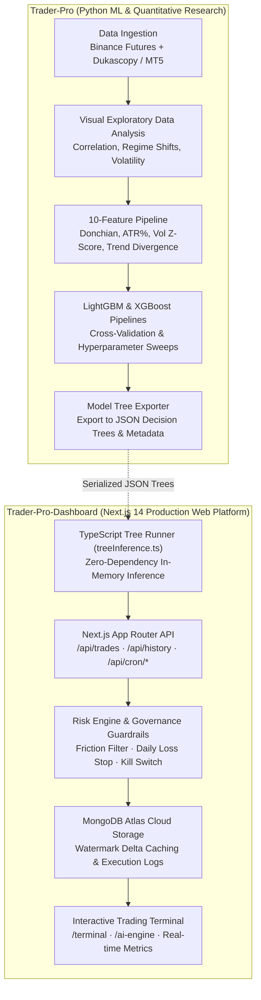
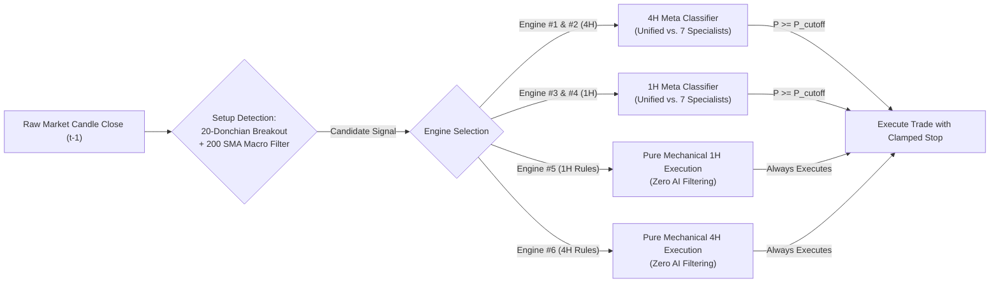

# System Architecture: Multi-Asset Unified & Distributed Meta-Labeling Engines (1H & 4H)

> **Canonical Document**: `docs/ARCHITECTURE.md`  
> **Repository**: `Trader-Pro-Dashboard` (Runtime & Web Terminal) & `Trader-Pro` (ML Research & Ingestion)  
> **Status**: Production System Architecture  
> **Date**: November 2026

---

## 1. System Overview & Rationale

Trader-Pro has evolved from single-coin high-frequency experiments into an institutional **Multi-Asset Quantitative Ecosystem**. The platform operates across a **7-asset multi-market universe** (Crypto + Macro Commodities) on **1-Hour (1H)** and **4-Hour (4H)** timeframes.

### Why 1H and 4H Horizons Over Intraday (5m/15m)?
1. **Fee Drag Elimination**: Average stop distances on 1H ($1.0\% - 4.0\%$) and 4H ($1.5\% - 6.0\%$) compress round-trip exchange friction to $\text{cost\_R} \le 0.08\text{R}$ (vs. $0.45\text{R}$ on 5m intraday bars).
2. **Economic Signal Quality**: 1H and 4H candles filter microstructure noise and capture genuine macroeconomic flow, multi-day institutional momentum, and Donchian channel expansions.
3. **Tax & Churn Efficiency**: Slower holding periods (up to 24 bars on 1H, up to 12 bars on 4H) reduce annual transaction volume, avoiding capital destruction from statutory taxation and high turnover.

---

## 2. Decoupled Two-Repository Architecture

To maintain zero runtime bloat and optimal separation of concerns, the project is decoupled into two specialized repositories:

---

## 3. The 6 Production Trading Engines

Trader-Pro deploys 6 live production engines running side-by-side to benchmark AI gating against pure mechanical rules:

### Engine Specifications

| # | Engine Key | Timeframe | Architecture | Filter / Gating Mechanism | Live Net R (Oct 21 – Nov 7) |
| :-: | :--- | :-: | :--- | :--- | :-: |
| **1** | `swing-4h` | **4H** | Unified 7-Asset | LightGBM Meta-Classifier ($P \ge 0.50$) | **+10.95 R** (80% Win) |
| **2** | `distributed-4h-specialist` | **4H** | 7 Distributed Specialists | Asset-Specific LightGBM ($P \ge 0.50$) | **+10.95 R** (80% Win) |
| **3** | `unified-1h-7assets` | **1H** | Unified 7-Asset | LightGBM Meta-Classifier ($P \ge 0.45$) | **+13.68 R** (56.1% Win) |
| **4** | `distributed-1h-specialist` | **1H** | 7 Distributed Specialists | Asset-Specific LightGBM ($P \ge 0.45$) | **+15.54 R** (58.1% Win) |
| **5** | `pure-rules-1h-baseline` | **1H** | Pure Mechanical Rules | Zero AI Filter (20-Donchian + 200 SMA) | **+5.32 R** (44.7% Win) |
| **6** | `pure-rules-4h-baseline` | **4H** | Pure Mechanical Rules | Zero AI Filter (20-Donchian + 200 SMA) | **+0.42 R** (47.6% Win) |

---

## 4. Multi-Asset Universe & Feature Specification

The portfolio covers 7 non-correlated liquid instruments:
- **Crypto Perps**: `BTCUSDT`, `ETHUSDT`, `SOLUSDT`, `DOTUSDT`
- **Macro Commodities**: `XAUUSDT` (Gold), `XAGUSDT` (Silver), `CLUSDT` (WTI Crude Oil)

### The 10 Core Input Features
Both 1H and 4H models evaluate candidates using 10 causal, point-in-time features computed identically across all assets:

1. `feat_donchian_pos`: Distance from current close to 20-bar Donchian channel midline normalized by channel width.
2. `feat_sma200_dist`: Percentage distance from close to 200-bar simple moving average ($\frac{\text{Close} - \text{SMA}_{200}}{\text{SMA}_{200}}$).
3. `feat_atr_pct`: Normalized Average True Range over 14 bars ($\frac{\text{ATR}_{14}}{\text{Close}}$).
4. `feat_vol_zscore`: Z-score of trading volume relative to 50-bar rolling mean and standard deviation.
5. `feat_stop_pct`: Raw structural distance from entry price to the 20-bar lowest low (for longs) or highest high (for shorts).
6. `feat_cost_r`: Mathematical fee drag ratio ($\frac{\text{round\_trip\_friction}}{\text{stop\_pct}}$).
7. `feat_return_1d`: Trailing return over 24 1H bars (or 6 4H bars).
8. `feat_return_3d`: Trailing return over 72 1H bars (or 18 4H bars).
9. `feat_high_low_ratio`: Ratio of current candle range to rolling 14-bar mean candle range.
10. `feat_trend_slope`: 10-bar linear regression slope of the 50-bar exponential moving average.

---

## 5. In-Memory TypeScript Inference Engine

To guarantee zero latency and absolute reliability without requiring Python runtime dependencies in production, `Trader-Pro-Dashboard` implements a native TypeScript decision tree inference engine (`src/lib/treeInference.ts`):

- **Zero External Dependencies**: Traverses binary decision trees directly in Node.js / V8 memory.
- **Microsecond Evaluation**: Computes full ensemble tree voting in `< 0.2ms`.
- **Fault-Tolerant NaN Handling**: Automatically follows tree default missing-value paths if any feature is undefined.
- **Sigmoid Output**: Computes mathematically bounded probabilities $P \in [0, 1]$:
  $$P(\text{Success}) = \frac{1}{1 + e^{-\sum \text{leaf\_values}}}$$

---

## 6. Execution Cadence & Point-in-Time Causality

- **1-Hour Execution**: Triggers exactly at the close of every hourly bar ($xx:00:00\text{ UTC}$).
- **4-Hour Execution**: Triggers exactly at the close of 4-hour bars ($00:00, 04:00, 08:00, 12:00, 16:00, 20:00\text{ UTC}$).
- **Trade Lifecycle Invariants**:
  - *Upper Target (Take Profit)*: $+2.5\text{R}$ (Fixed target based on structural stop risk).
  - *Lower Barrier (Stop Loss)*: $-1.0\text{R}$ (Structural swing boundary clamped between `[1.0%, 4.0%]` on 1H and `[1.5%, 6.0%]` on 4H).
  - *Time Barrier Expiry*: Maximum holding period of 24 bars on 1H (24 hours) or 12 bars on 4H (48 hours). If neither barrier is touched, exit at market close of the final bar.
  - *Simultaneous Touch Collision*: If both Take Profit and Stop Loss levels are breached within the same candle, governance invariant strictly books the trade as a **Stop Loss ($-1.0\text{R}$)**.
