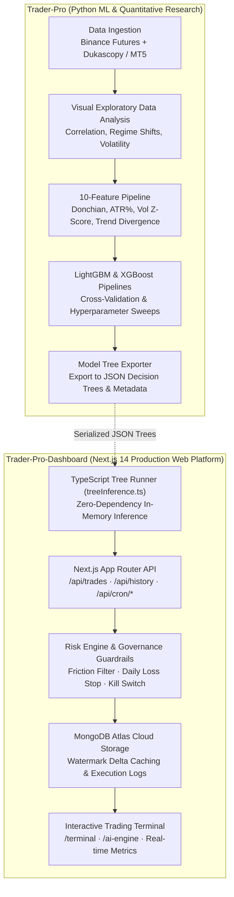
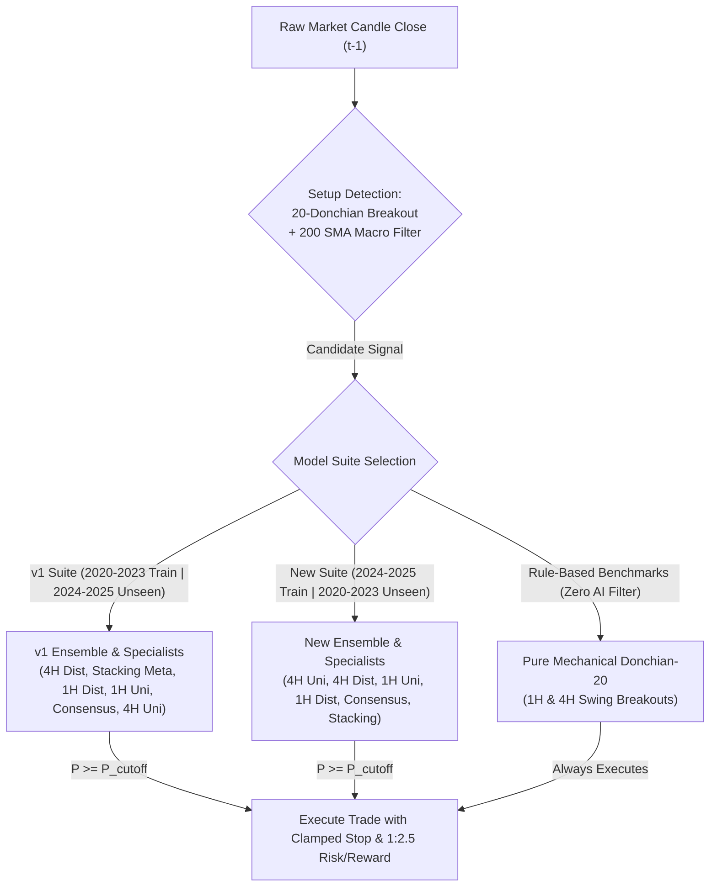

# System Architecture: Multi-Asset Unified & Distributed Meta-Labeling Engines (1H & 4H)

> **Canonical Document**: `docs/ARCHITECTURE.md`  
> **Repository**: `Trader-Pro-Dashboard` (Runtime & Web Terminal) & `Trader-Pro` (ML Research & Ingestion)  
> **Status**: Production System Architecture  
> **Date**: November 2026

---

## 1. System Overview & Rationale

Trader-Pro has evolved from single-coin high-frequency experiments into an institutional **Multi-Asset Quantitative Ecosystem**. The platform operates across a **7-asset multi-market universe** (Crypto + Macro Commodities) on **1-Hour (1H)** and **4-Hour (4H)** timeframes.

### Why 1H and 4H Horizons Over Intraday (5m/15m)?
1. **Fee Drag Elimination**: Average stop distances on 1H ($1.0\% - 4.0\%$) and 4H ($1.5\% - 6.0\%$) compress round-trip exchange friction to $\text{cost\_R} \le 0.08\text{R}$ (vs. $0.45\text{R}$ on 5m intraday bars).
2. **Economic Signal Quality**: 1H and 4H candles filter microstructure noise and capture genuine macroeconomic flow, multi-day institutional momentum, and Donchian channel expansions.
3. **Tax & Churn Efficiency**: Slower holding periods (up to 24 bars on 1H, up to 12 bars on 4H) reduce annual transaction volume, avoiding capital destruction from statutory taxation and high turnover.

---

## 2. Decoupled Two-Repository Architecture

To maintain zero runtime bloat and optimal separation of concerns, the project is decoupled into two specialized repositories:

---

## 3. Dual-Suite Production Engines (14 Models Hosted Concurrently)

Trader-Pro hosts both the **`v1` Suite (Trained 2020–2023)** and the **`New` Suite (Trained 2024–2025)** simultaneously, along with mechanical benchmarks, on the `/ai-engine` selector and backend REST routes:

### Complete 14-Model Production Specifications

| Rank | Engine Identifier | Suite | Timeframe | Architecture | Gating Threshold | Unseen Window | Unseen Trades / WR / Return | Live Window (Oct 21 – Nov 07, 2026) |
| :---: | :--- | :---: | :---: | :--- | :---: | :---: | :---: | :---: |
| **#1** | `v1-distributed-4h-engine` | `v1` | **4H** | 7 Dedicated Per-Asset Models | $P \ge 0.50$ | 2024–2025 (2 Yrs) | 336 trades (53.3% WR, **+40.88R**, 1.41 PF) | 11 trades (**72.7% WR**, **+1.19R**) |
| **#2** | `v1-stacking-meta-engine` | `v1` | **1H** | Logistic Meta-Learner Ensemble | $P \ge 0.48$ | 2024–2025 (2 Yrs) | 1,669 trades (47.8% WR, **+30.05R**, 1.05 PF) | 27 trades (**51.9% WR**, -0.79R) |
| **#3** | `v1-distributed-1h-engine` | `v1` | **1H** | 7 Dedicated Per-Asset Models | $P \ge 0.45$ | 2024–2025 (2 Yrs) | 1,659 trades (47.7% WR, **+31.46R**, 1.05 PF) | 25 trades (48.0% WR, -2.48R) |
| **#4** | `v1-unified-1h-engine` | `v1` | **1H** | 1 Universal LightGBM Brain | $P \ge 0.45$ | 2024–2025 (2 Yrs) | 2,527 trades (46.6% WR, **+5.85R**, 1.01 PF) | 46 trades (47.8% WR, **+1.19R**) |
| **#5** | `v1-consensus-committee-engine` | `v1` | **1H** | Dual-Gating Agreement Committee | Unified & Spec $\ge 0.45$ | 2024–2025 (2 Yrs) | 1,404 trades (47.1% WR, **+0.33R**, 1.00 PF) | 21 trades (47.6% WR, -1.96R) |
| **#6** | `v1-unified-4h-engine` | `v1` | **4H** | 1 Universal LightGBM Brain | $P \ge 0.50$ | 2024–2025 (2 Yrs) | 53 trades (45.3% WR, -1.43R, 0.93 PF) | 1 trade (**100% WR**, **+0.39R**) |
| **#7** | `unified-4h-engine` | `New` | **4H** | 1 Universal LightGBM Brain | $P \ge 0.50$ | 2020–2023 (4 Yrs) | 511 trades (46.6% WR, **+26.71R**, 1.16 PF) | 1 trade (0.0% WR, -0.76R) |
| **#8** | `distributed-4h-engine` | `New` | **4H** | 7 Dedicated Per-Asset Models | $P \ge 0.50$ | 2020–2023 (4 Yrs) | 1,086 trades (46.9% WR, **+7.34R**, 1.02 PF) | 9 trades (**77.8% WR**, **+2.20R**) |
| **#9** | `unified-1h-engine` | `New` | **1H** | 1 Universal LightGBM Brain | $P \ge 0.45$ | 2020–2023 (4 Yrs) | 4,403 trades (44.7% WR, -47.04R, 0.97 PF) | 32 trades (43.8% WR, -1.84R) |
| **#10** | `distributed-1h-engine` | `New` | **1H** | 7 Dedicated Per-Asset Models | $P \ge 0.45$ | 2020–2023 (4 Yrs) | 4,376 trades (43.9% WR, -151.17R, 0.92 PF) | 32 trades (**56.2% WR**, -0.07R) |
| **#11** | `new-consensus-committee-engine` | `New` | **1H** | Dual-Gating Agreement Committee | Unified & Spec $\ge 0.45$ | 2020–2023 (4 Yrs) | 3,381 trades (44.6% WR, -28.35R, 0.98 PF) | 37 trades (35.1% WR, -9.90R) |
| **#12** | `new-stacking-meta-engine` | `New` | **1H** | Logistic Meta-Learner Ensemble | $P \ge 0.48$ | 2020–2023 (4 Yrs) | 3,678 trades (43.9% WR, -91.17R, 0.94 PF) | 39 trades (33.3% WR, -11.98R) |
| **#13** | `pure-rules-4h-baseline` | Benchmark | **4H** | Mechanical (No AI Gating) | None | 2020–2023 (4 Yrs) | 2,005 trades (46.0% WR, **+47.11R**, 1.07 PF) | 21 trades (**61.9% WR**, **+1.97R**) |
| **#14** | `pure-rules-1h-baseline` | Benchmark | **1H** | Mechanical (No AI Gating) | None | 2020–2023 (4 Yrs) | 6,217 trades (43.3% WR, -131.54R, 0.95 PF) | 62 trades (46.8% WR, -3.60R) |

### REST API Routing Architecture
- **Live Paper Trades (`/api/trades?modelId=<id>`):** Loads each engine's corresponding live trades dataset (`v1_*_live_trades.json` for `v1-*` models, `distributed_*` or `live_*` for `New` models, and `pure_rules_*` for benchmarks).
- **Unseen Trade History (`/api/history?modelId=<id>`):** Seamlessly queries each engine's verified out-of-sample holdout dataset (`v1_*_unseen_trades.json` or `*_historical_trades.json`) with server-side pagination, asset filtering, and side/outcome filters.

---

## 4. Multi-Asset Universe & Feature Specification

The portfolio covers 7 non-correlated liquid instruments:
- **Crypto Perps**: `BTCUSDT`, `ETHUSDT`, `SOLUSDT`, `DOTUSDT`
- **Macro Commodities**: `XAUUSDT` (Gold), `XAGUSDT` (Silver), `CLUSDT` (WTI Crude Oil)

### The 10 Core Input Features
Both 1H and 4H models evaluate candidates using 10 causal, point-in-time features computed identically across all assets:

1. `feat_donchian_pos`: Distance from current close to 20-bar Donchian channel midline normalized by channel width.
2. `feat_sma200_dist`: Percentage distance from close to 200-bar simple moving average ($\frac{\text{Close} - \text{SMA}_{200}}{\text{SMA}_{200}}$).
3. `feat_atr_pct`: Normalized Average True Range over 14 bars ($\frac{\text{ATR}_{14}}{\text{Close}}$).
4. `feat_vol_zscore`: Z-score of trading volume relative to 50-bar rolling mean and standard deviation.
5. `feat_stop_pct`: Raw structural distance from entry price to the 20-bar lowest low (for longs) or highest high (for shorts).
6. `feat_cost_r`: Mathematical fee drag ratio ($\frac{\text{round\_trip\_friction}}{\text{stop\_pct}}$).
7. `feat_return_1d`: Trailing return over 24 1H bars (or 6 4H bars).
8. `feat_return_3d`: Trailing return over 72 1H bars (or 18 4H bars).
9. `feat_high_low_ratio`: Ratio of current candle range to rolling 14-bar mean candle range.
10. `feat_trend_slope`: 10-bar linear regression slope of the 50-bar exponential moving average.

---

## 5. In-Memory TypeScript Inference Engine

To guarantee zero latency and absolute reliability without requiring Python runtime dependencies in production, `Trader-Pro-Dashboard` implements a native TypeScript decision tree inference engine (`src/lib/treeInference.ts`):

- **Zero External Dependencies**: Traverses binary decision trees directly in Node.js / V8 memory.
- **Microsecond Evaluation**: Computes full ensemble tree voting in `< 0.2ms`.
- **Fault-Tolerant NaN Handling**: Automatically follows tree default missing-value paths if any feature is undefined.
- **Sigmoid Output**: Computes mathematically bounded probabilities $P \in [0, 1]$:
  $$P(\text{Success}) = \frac{1}{1 + e^{-\sum \text{leaf\_values}}}$$

---

## 6. Execution Cadence & Point-in-Time Causality

- **1-Hour Execution**: Triggers exactly at the close of every hourly bar ($xx:00:00\text{ UTC}$).
- **4-Hour Execution**: Triggers exactly at the close of 4-hour bars ($00:00, 04:00, 08:00, 12:00, 16:00, 20:00\text{ UTC}$).
- **Trade Lifecycle Invariants**:
  - *Upper Target (Take Profit)*: $+2.5\text{R}$ (Fixed target based on structural stop risk).
  - *Lower Barrier (Stop Loss)*: $-1.0\text{R}$ (Structural swing boundary clamped between `[1.0%, 4.0%]` on 1H and `[1.5%, 6.0%]` on 4H).
  - *Time Barrier Expiry*: Maximum holding period of 24 bars on 1H (24 hours) or 12 bars on 4H (48 hours). If neither barrier is touched, exit at market close of the final bar.
  - *Simultaneous Touch Collision*: If both Take Profit and Stop Loss levels are breached within the same candle, governance invariant strictly books the trade as a **Stop Loss ($-1.0\text{R}$)**.
