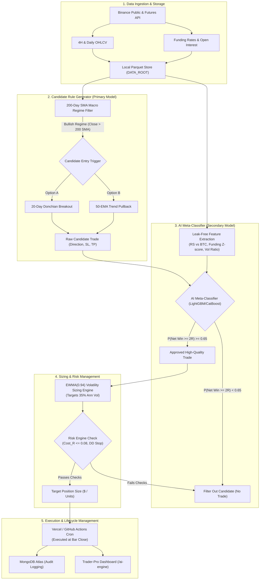

# System Architecture: 4H / Daily Swing Meta-Labeling Engine

> **Canonical Document**: `docs/ARCHITECTURE.md`  
> **Repository**: `Trader-Pro` / `Trader-Pro-Dashboard`  
> **Status**: Architectural Blueprint for Current Development (`feat/daily-4h-swing-engine`)

---

## 1. System Overview & Rationale

Trader-Pro's core algorithmic pipeline is fundamentally pivoted away from high-frequency intraday churn (5m/15m) toward a macro-aware **4-Hour (4H) / Daily (1D) Swing Meta-Labeling Architecture**. 

At the 4H/Daily timeframe:
- **Fee Drag is Negligible**: Average stop distances are $2.5\% - 5.5\%$, reducing round-trip exchange friction to **$\text{cost\_R} \le 0.04\text{R}$** (compared to $0.45\text{R}$ on 5m bars).
- **Tax (TDS) Efficiency**: Daily holding periods dramatically curtail annual trade count ($< 60$ trades per asset/year), preventing capital erosion under Indian 1% TDS rules.
- **Signal Quality**: Macro trend structure, funding rate extremes, and relative strength divergence provide genuine economic information rather than high-frequency microstructure noise.

---

## 2. End-to-End Architectural Flow

---

## 3. Component Specifications

### Component 1: Candidate Rule Generator (Primary Model)
- **Role**: Discovers structural market opportunities with positive gross asymmetry (high profit-to-loss ratio).
- **Macro Filter**:
  - Longs permitted only when $\text{Close}_t > \text{SMA}_{200}(\text{Close})_t$.
  - Shorts permitted only when $\text{Close}_t < \text{SMA}_{200}(\text{Close})_t$.
- **Triggers**:
  1. *20-Day Breakout*: New 20-day high close with expansion in 20-period volume.
  2. *50-EMA Pullback*: In an established trend ($\text{Close} > \text{EMA}_{50} > \text{SMA}_{200}$), price pulls back into the $1.5 \times \text{ATR}$ channel around $\text{EMA}_{50}$ and prints a reversal candle.

### Component 2: AI Meta-Classifier (Secondary Model)
- **Concept (Marcos López de Prado)**: The machine learning model does NOT predict price direction directly. Instead, it acts as a **trade quality filter (meta-labeler)**:
  $$\text{Given a primary candidate trade } c \text{ with direction } d \in \{+1, -1\}, \quad \text{predict } P(R_{\text{net}} \ge 2.0\text{R})$$
- **Model**: LightGBM / CatBoost gradient boosted decision trees.
- **Classification Threshold**:
  $$P(\text{Trade Quality} = 1) \ge 0.65$$
  Trades with predicted probability $< 0.65$ are skipped, filtering out false breakouts and choppy consolidation whipsaws.

### Component 3: Volatility Sizing Engine
- **Target Annualized Volatility**: $\sigma_{\text{target}} = 35.0\%$.
- **Current Volatility Estimation**:
  $$\sigma_t^2 = 0.94\,\sigma_{t-1}^2 + 0.06\,r_{t-1}^2$$
  $$\hat{\sigma}_{\text{ann}, t} = \sqrt{\sigma_t^2 \times 365}$$
- **Position Sizing Formula**:
  $$\text{Weight}_t = \text{clamp}\left(\frac{\sigma_{\text{target}}}{\hat{\sigma}_{\text{ann}, t}}, 0.20, 1.50\right)$$
- When market volatility spikes, the position size contracts automatically; during quiet, steady trends, position size expands within conservative bounds.

### Component 4: Execution & Lifecycle Cadence
- **Cadence**: 4-Hour bars ($00:00, 04:00, 08:00, 12:00, 16:00, 20:00\text{ UTC}$) and Daily bar ($00:00\text{ UTC}$).
- **In-Browser Animated AI Cursor**: Visual DOM cursor streams executions seamlessly across the dashboard terminal while maintaining full sandboxing.
- **Trade Lifecycle Monitoring**:
  - *Upper Target*: $+2.5\text{R}$ (Limit or trailing trigger).
  - *Initial Stop Loss*: $-1.0\text{R}$ (Structural swing high/low or $2.0 \times \text{ATR}$).
  - *Time Barrier*: $12 \times 4\text{H}$ bars ($48\text{ hours}$ max holding period if neither barrier is touched).
  - *Collision Protection*: Same-bar touches are booked strictly as Stop-Loss ($-1.0\text{R}$).

---

## 4. Leakage-Free Design Invariants

1. **Zero Intra-Bar Lookahead**: Inferences occur strictly at candle close using data from bars $t-1$ and earlier.
2. **Proper HTF Alignment**: Daily/weekly trend filters are calculated on completed calendar days, never open intraday bars.
3. **Turnover & Slippage Reality**: All strategy evaluations assume realistic exchange taker fees ($0.1144\%$), GST, and slippage.
