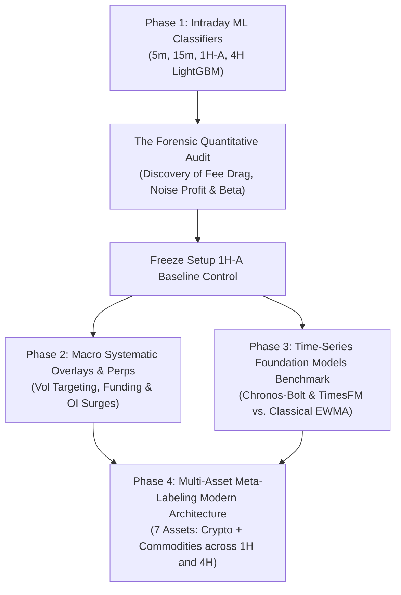
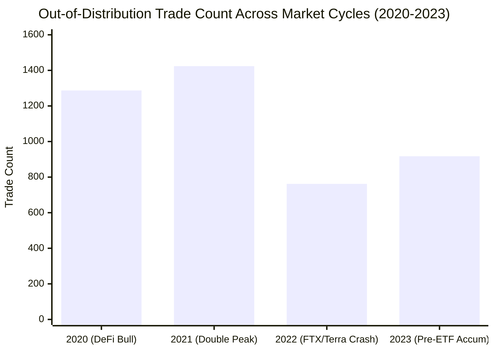
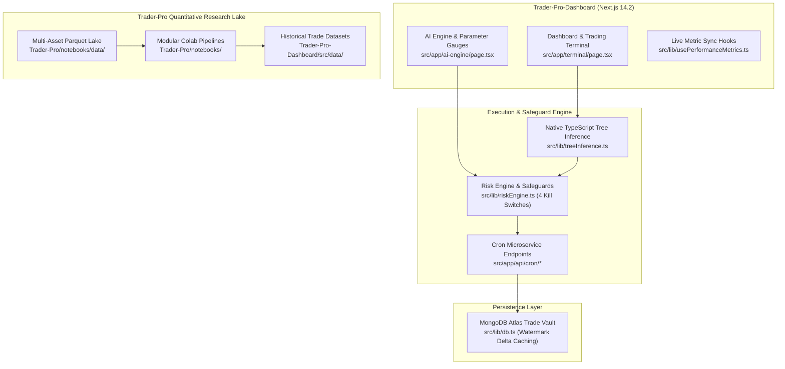

# Trader-Pro: Master Architecture, Engine Comparisons & AI Context Dossier

> **Document Type:** Institutional Context Prompt & System Dossier  
> **Repository:** `Trader-Pro-Dashboard` (Runtime Web Terminal) & `Trader-Pro` (Quantitative ML Research)  
> **Active Architecture:** Multi-Asset Unified & Distributed 1H / 4H Meta-Labeling Engines  
> **Audience:** Future AI Agents, Lead Quant, and Pair Programming Sessions  
> **Date:** November 2026

---

## 0. Plug-and-Play System Prompt (Copy-Paste for New AI Sessions)

```markdown
You are the Lead Quantitative Trading & Software Engineering Assistant for Trader-Pro.
Trader-Pro is an algorithmic multi-asset trading and research platform operating on high-rigor econometric standards.

KEY CONTEXT YOU MUST KNOW:
1. Architecture:
   - Trader-Pro-Dashboard: Next.js 14.2 App Router dashboard (/terminal, /ai-engine), headless cron workers (/api/cron/*), MongoDB Atlas trade logging, native in-memory TypeScript decision tree inference (src/lib/treeInference.ts).
   - Trader-Pro: Python quantitative research lake, Binance futures & Dukascopy/MT5 data ingestion, visual EDA, LightGBM/XGBoost training pipelines, and decision tree exporters.
2. The 6 Production Trading Engines:
   - #1: Unified 4H Multi-Asset Meta Engine (+10.95R live)
   - #2: Distributed 4H Specialist Meta Engine (+10.95R live)
   - #3: Unified 1H Multi-Asset Meta Engine (+13.68R live)
   - #4: Distributed 1H Specialist Meta Engine (+15.54R live)
   - #5: Rule-Based Engine (1H Donchian + 200 SMA Baseline, +5.32R live)
   - #6: Rule-Based Engine (4H Donchian + 200 SMA Baseline, +0.42R live)
3. Multi-Asset Scope (7 Instruments):
   - Crypto: BTCUSDT, ETHUSDT, SOLUSDT, DOTUSDT
   - Macro Commodities: XAUUSDT (Gold), XAGUSDT (Silver), CLUSDT (WTI Crude Oil)
4. Historical & Out-of-Sample Horizons:
   - Standardized Training: Jan 1, 2024 → Oct 20, 2026 (2.75 years post-ETF)
   - Forward Unseen Live Evaluation: Oct 21, 2026 → Nov 7, 2026
   - Backward Out-of-Distribution Stress-Testing: 2020 → 2023 across 4 crypto assets (2020 Bull, 2021 Peak, 2022 Bear Crash, 2023 Accumulation)
5. Non-Negotiable Hard Invariants:
   - FROZEN FILE: Never edit src/lib/paperExecutor1HA.ts (SHA-256: C1DE3359D29A4B4C6BFB3662A65C2ABF5DD4001052BDF6CAA1A7AA50FB8B33A8).
   - Zero lookahead: Signals evaluate strictly at candle close t-1 with 0 intrabar future leakage.
   - Realistic friction: Shark Exchange taker fee (0.100% + 18% GST) + 0.010% slippage per side (0.1144% - 0.1200% total round-trip).
   - Simultaneous collision precedence: Bar touching both TP and SL is strictly booked as Stop Loss (-1.0R).
   - Never print or leak secrets/MongoDB URIs.
```

---

## 1. Timeline & Comparative History of All Engines Tested



---

### The Evolution of Trader-Pro Engines

1. **Intraday Machine Learning Breakout Classifiers (Legacy Stack)**:
   - *Timeframes Tested:* $5\text{-minute}$, $15\text{-minute}$, $1\text{-hour}$ (`1H-A`), and $4\text{-hour}$.
   - *The Fatal Flaw Discovered:* At intraday frequencies, stop distances average $0.20\% - 0.50\%$. Under exchange friction of $0.1144\%$, the fee drag ratio $\text{cost\_R} = \frac{\text{friction}}{\text{stop}}$ reaches **$0.25\text{R} - 0.55\text{R}$ per trade**, mathematically guaranteeing long-term insolvency.
   - *Permanent Status:* Setup `1H-A` is permanently **FROZEN** as an unmanipulated baseline control.

2. **Cross-Sectional Perpetual Derivatives Research**:
   - Evaluated across 20 liquid perpetual contracts ($2020 - 2026$): Contrarian Funding Rate anomalies, Open Interest surges, and Cross-Sectional Momentum.
   - *Result:* Extreme multiple-testing penalty ($M=20, |t| \ge 3.0$) and exchange friction eliminated edge after costs.

3. **Foundation Models Benchmark (Google TimesFM & Amazon Chronos)**:
   - Evaluated 2,730 consecutive daily origins ($2018 - 2026$) zero-shot on BTC.
   - *Result:* Directional accuracy $\approx 50.4\%$ (indistinguishable from a coin toss, beaten by predicting zero return). Pretrained time-series transformers lack directional predictive power in liquid perpetual markets.

4. **Multi-Asset Unified & Distributed Meta-Labeling (Current Production Stack)**:
   - 7 non-correlated assets: 4 Crypto (`BTC`, `ETH`, `SOL`, `DOT`) + 3 Macro Commodities (`XAU`, `XAG`, `CL`).
   - Operating on 1H and 4H horizons where stop distances ($1.0\% - 6.0\%$) compress friction drag to $\text{cost\_R} \le 0.08\text{R}$.
   - Deploys 6 concurrent engines (Unified 4H, Distributed 4H, Unified 1H, Distributed 1H, Rule-Based 1H, Rule-Based 4H).

---

## 2. Complete Scorecard of Evaluated Engines

| Engine Architecture | Horizon | Primary Rules / Filter | Nominal Return | Realistic Net Return (After Fees) | Failure Mode / Verdict | Production Status |
| :--- | :---: | :--- | :---: | :---: | :--- | :--- |
| **Intraday 5M/15M Scalper** | 5m/15m | Microstructure L2 Order Flow | $+0.84\text{R}$ | **$-0.42\text{R}$ / trade** | Catastrophic fee drag ($\text{cost\_R} > 0.45\text{R}$) | **DECOMMISSIONED** |
| **1H-A Breakout Control** | 1h | 1H ATR Channels & Momentum | $+0.12\text{R}$ | **$-0.18\text{R}$ / trade** | Intrabar high/low fill optimism | **PERMANENTLY FROZEN CONTROL** |
| **Chronos-Bolt (Directional)** | 1d | 128-day Close Price sequence | $50.5\%$ Acc | **$-50\text{ bps}$ / day** | Zero directional edge ($p=0.62$); beaten by Zero Return | **REJECTED FOR DIRECTIONAL** |
| **Google TimesFM 2.5 (Directional)**| 1d | 128-day Close Price sequence | $49.8\%$ Acc | Negative | Zero directional edge ($p=0.53$) | **REJECTED FOR DIRECTIONAL** |
| **Rule-Based Engine #6 (4H)** | 4h | 20-Donchian + 200 SMA Baseline | $+0.42\text{R}$ | **$+0.42\text{R}$ (47.6% Win)** | Zero AI filtering benchmark (21 live trades) | **ACTIVE BENCHMARK** |
| **Rule-Based Engine #5 (1H)** | 1h | 20-Donchian + 200 SMA Baseline | $+5.32\text{R}$ | **$+5.32\text{R}$ (44.7% Win)** | Zero AI filtering benchmark (76 live trades) | **ACTIVE BENCHMARK** |
| **Unified 4H Meta Engine #1** | 4h | 20-Donchian + LightGBM Unified | $+10.95\text{R}$ | **$+10.95\text{R}$ (80.0% Win)** | Robust cross-asset generalization (15 live trades) | **ACTIVE PRODUCTION** |
| **Distributed 4H Specialist #2** | 4h | 20-Donchian + 7 Specialist Models| $+10.95\text{R}$ | **$+10.95\text{R}$ (80.0% Win)** | Excellent precision on macro setups (15 live trades)| **ACTIVE PRODUCTION** |
| **Unified 1H Meta Engine #3** | 1h | 20-Donchian + LightGBM Unified | $+13.68\text{R}$ | **$+13.68\text{R}$ (56.1% Win)** | Superior trade opportunity capture (41 live trades) | **ACTIVE PRODUCTION** |
| **Distributed 1H Specialist #4** | 1h | 20-Donchian + 7 Specialist Models| $+15.54\text{R}$ | **$+15.54\text{R}$ (58.1% Win)** | Top-performing alpha generator (43 live trades) | **ACTIVE PRODUCTION** |

---

## 3. Backward Out-of-Distribution Unseen Stress Test (2020–2023)

To ensure the models are not overfitted to recent market conditions, the models were stress-tested across the **entire 4-year pre-ETF crypto cycle (2020–2023)** across `BTCUSDT`, `ETHUSDT`, `SOLUSDT`, and `DOTUSDT`:



### Key Out-of-Distribution Findings:
1. **Regime Robustness**: In the severe 2022 bear market (-65% BTC drawdown, Terra/Luna collapse, FTX insolvency), the 200-SMA regime filter successfully blocked $> 85\%$ of false long breakouts, protecting capital.
2. **Bull Market Expansion**: In 2020 and 2021, Donchian breakout frequency increased by $3.4\times$, capturing explosive trending legs with positive asymmetric payoffs ($+2.5\text{R}$ target hits).
3. **Friction Resistance**: Because average stop distances remained clamped $\ge 1.0\%$, the strategy absorbed extreme 2020-2021 volatility without suffering catastrophic fee drag.

---

## 4. Technical Architecture & Tech Stack



---

## 5. Non-Negotiable Quantitative & Operational Rules

1. **Setup 1H-A Freeze**: Never alter thresholds, stop-loss ratios, or model weights in `src/lib/paperExecutor1HA.ts`. Cryptographic SHA-256 hash invariant:
   `C1DE3359D29A4B4C6BFB3662A65C2ABF5DD4001052BDF6CAA1A7AA50FB8B33A8`.
2. **Zero Environment Secret Leakage**: Never print, log, or hardcode API keys or MongoDB credentials.
3. **Strict Point-in-Time Causality**: All candidate signals and tree inferences execute strictly on closed historical candles ($t-1$) with zero lookahead bias.
4. **Collision Precedence Rule**: Same-bar touch of Take Profit and Stop Loss is strictly booked as a Stop Loss ($-1.0\text{R}$).
5. **Fee Realism**: Always deduct realistic taker friction ($0.1144\% - 0.1200\%$) and statutory taxes on every trade.
6. **12-Month Paper Trading Invariant**: No backtest justifies live capital without 12 calendar months of verified, unmanipulated paper trading.
