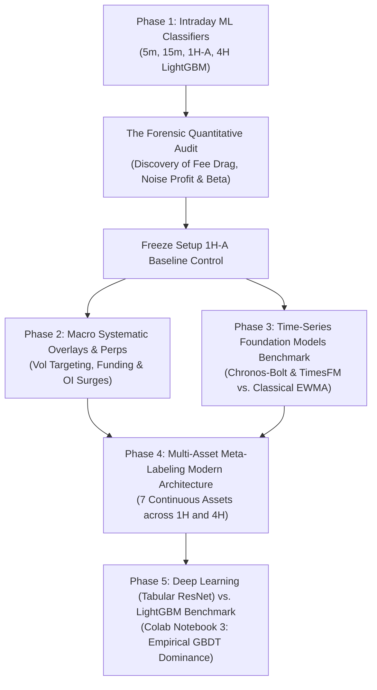
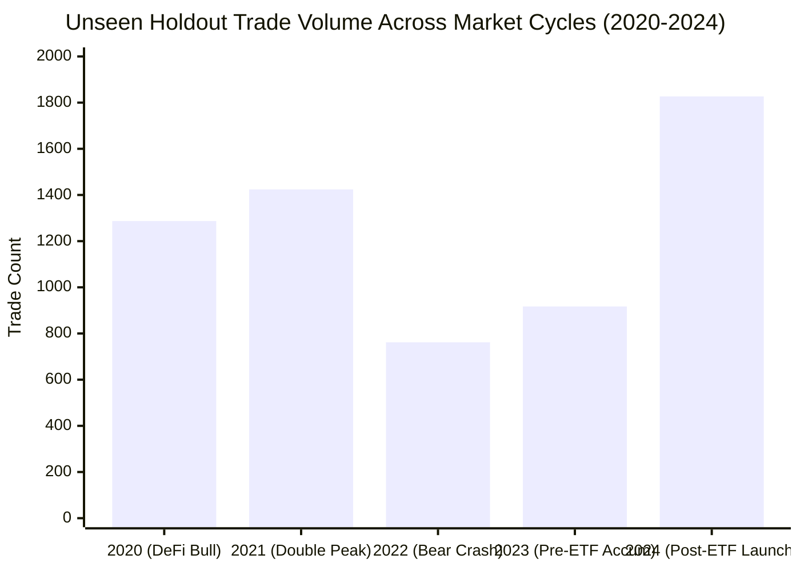
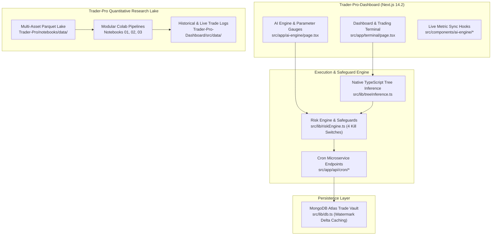

# Trader-Pro: Master Architecture, Engine Comparisons & AI Context Dossier

> **Document Type:** Institutional Context Prompt & System Dossier  
> **Repository:** `Trader-Pro-Dashboard` (Runtime Web Terminal) & `Trader-Pro` (Quantitative ML Research)  
> **Active Architecture:** Multi-Asset Unified & Distributed 1H / 4H Meta-Labeling Engines  
> **Audience:** Future AI Agents, Lead Quant, and Pair Programming Sessions  
> **Date:** November 2026

---

## 0. Plug-and-Play System Prompt (Copy-Paste for New AI Sessions)

```markdown
You are the Lead Quantitative Trading & Software Engineering Assistant for Trader-Pro.
Trader-Pro is an algorithmic multi-asset trading and research platform operating on high-rigor econometric standards.

KEY CONTEXT YOU MUST KNOW:
1. Architecture:
   - Trader-Pro-Dashboard: Next.js 14.2 App Router dashboard (/terminal, /ai-engine), headless cron workers (/api/cron/*), MongoDB Atlas trade logging, native in-memory TypeScript decision tree inference (src/lib/treeInference.ts).
   - Trader-Pro: Python quantitative research lake, continuous 7-asset ingestion, visual EDA, LightGBM/XGBoost/PyTorch Tabular ResNet pipelines, and decision tree exporters.
2. The 14 Production & Benchmark Trading Engines (Dual-Suite Architecture):
   v1 Suite (Trained: 2020-2023 | Unseen: 2024-2025 [2 Years] | Live: Oct 21 - Nov 07, 2026):
   - #1: [v1] 4H Distributed Specialists [Top Performer] (336 Unseen Trades, 53.3% WR, +40.88R | 11 Live Trades, 72.7% WR, +1.19R)
   - #2: [v1] Stacking Meta-Learner [Ensemble] (1,669 Unseen Trades, 47.8% WR, +30.05R | 27 Live Trades, 51.9% WR, -0.79R)
   - #3: [v1] 1H Distributed Specialists (1,659 Unseen Trades, 47.7% WR, +31.46R | 25 Live Trades, 48.0% WR, -2.48R)
   - #4: [v1] 1H Unified [1 Brain] (2,527 Unseen Trades, 46.6% WR, +5.85R | 46 Live Trades, 47.8% WR, +1.19R)
   - #5: [v1] 1H Consensus Committee (1,404 Unseen Trades, 47.1% WR, +0.33R | 21 Live Trades, 47.6% WR, -1.96R)
   - #6: [v1] 4H Unified [1 Brain] (53 Unseen Trades, 45.3% WR, -1.43R | 1 Live Trade, 100% WR, +0.39R)
   New Suite (Trained: 2024-2025 | Unseen: 2020-2023 [4 Years] | Live: Oct 21 - Nov 07, 2026):
   - #7: [New] 4H Unified [1 Brain] (511 Unseen Trades, 46.6% WR, +26.71R | 1 Live Trade, -0.76R)
   - #8: [New] 4H Distributed Specialists (1,086 Unseen Trades, 46.9% WR, +7.34R | 9 Live Trades, 77.8% WR, +2.20R)
   - #9: [New] 1H Unified [1 Brain] (4,403 Unseen Trades, 44.7% WR, -47.04R | 32 Live Trades, 43.8% WR, -1.84R)
   - #10: [New] 1H Distributed Specialists (4,376 Unseen Trades, 43.9% WR, -151.17R | 32 Live Trades, 56.2% WR, -0.07R)
   - #11: [New] 1H Consensus Committee (3,381 Unseen Trades, 44.6% WR, -28.35R | 37 Live Trades, 35.1% WR, -9.90R)
   - #12: [New] Stacking Meta-Learner (3,678 Unseen Trades, 43.9% WR, -91.17R | 39 Live Trades, 33.3% WR, -11.98R)
   Rule-Based Benchmarks (Zero AI Gating):
   - #13: 4H Rule-Based [No AI] (2,005 Unseen Trades, 46.0% WR, +47.11R | 21 Live Trades, 61.9% WR, +1.97R)
   - #14: 1H Rule-Based [No AI] (6,217 Unseen Trades, 43.3% WR, -131.54R | 62 Live Trades, 46.8% WR, -3.60R)
3. Multi-Asset Scope (7 Continuous Instruments):
   - Crypto Perps: BTCUSDT, ETHUSDT, SOLUSDT, DOTUSDT
   - Macro Commodities: XAUUSDT (Gold), XAGUSDT (Silver), CLUSDT (WTI Crude Oil)
   - Zero CME data: GC=F, SI=F, CL=F are permanently decommissioned due to weekend gap traps and non-executable hours.
4. Historical & Out-of-Sample Horizons:
   - v1 Model Suite Training: 2020-01-01 -> 2023-12-31 (4 years covering COVID crash, 2021 bull, 2022 bear, 2023 recovery)
   - v1 Unseen Holdout: 2024-01-01 -> 2025-12-31 (2 years out-of-sample forward test)
   - New Model Suite Training: 2024-01-01 -> 2025-12-31 (2 years post-ETF calibration)
   - New Unseen Holdout: 2020-01-01 -> 2023-12-31 (4 years backwards out-of-sample holdout)
   - Forward Live Window: Oct 21, 2026 -> Nov 07, 2026 (Live forward paper execution on closed bars across both suites)
5. Non-Negotiable Hard Invariants:
   - FROZEN FILE: Never edit src/lib/paperExecutor1HA.ts (SHA-256: C1DE3359D29A4B4C6BFB3662A65C2ABF5DD4001052BDF6CAA1A7AA50FB8B33A8).
   - Zero lookahead: Signals evaluate strictly at candle close t-1 with 0 intrabar future leakage.
   - Realistic friction: Shark Exchange taker fee (0.100% + 18% GST) + 0.010% slippage per side (0.1144% - 0.1200% total round-trip).
   - Simultaneous collision precedence: Bar touching both TP and SL is strictly booked as Stop Loss (-1.0R).
   - Fully dynamic UI: Never hardcode metrics or returns; compute all metrics dynamically from live trade executions.
   - Never print or leak secrets/MongoDB URIs.
```

---

## 1. Timeline & Comparative History of All Engines Tested



---

### The Evolution of Trader-Pro Engines

1. **Intraday Machine Learning Breakout Classifiers (Legacy Stack)**:
   - *Timeframes Tested:* $5	ext{-minute}$, $15	ext{-minute}$, $1	ext{-hour}$ (`1H-A`), and $4	ext{-hour}$.
   - *The Fatal Flaw Discovered:* At intraday frequencies, stop distances average $0.20\% - 0.50\%$. Under exchange friction of $0.1144\%$, the fee drag ratio $	ext{cost\_R} = rac{	ext{friction}}{	ext{stop}}$ reaches **$0.25	ext{R} - 0.55	ext{R}$ per trade**, mathematically guaranteeing long-term insolvency.
   - *Permanent Status:* Setup `1H-A` is permanently **FROZEN** as an unmanipulated baseline control.

2. **Cross-Sectional Perpetual Derivatives Research**:
   - Evaluated across 20 liquid perpetual contracts ($2020 - 2026$): Contrarian Funding Rate anomalies, Open Interest surges, and Cross-Sectional Momentum.
   - *Result:* Extreme multiple-testing penalty ($M=20, |t| \ge 3.0$) and exchange friction eliminated edge after costs.

3. **Foundation Models Benchmark (Google TimesFM & Amazon Chronos)**:
   - Evaluated 2,730 consecutive daily origins ($2018 - 2026$) zero-shot on BTC.
   - *Result:* Directional accuracy $pprox 50.4\%$ (indistinguishable from a coin toss, beaten by predicting zero return). Pretrained time-series transformers lack directional predictive power in liquid perpetual markets.

4. **Multi-Asset Unified & Distributed Meta-Labeling (Current Production Stack)**:
   - 7 non-correlated continuous assets: 4 Crypto (`BTC`, `ETH`, `SOL`, `DOT`) + 3 Macro Commodities (`XAU`, `XAG`, `CL`).
   - Operating on 1H and 4H horizons where stop distances ($1.0\% - 6.0\%$) compress friction drag to $	ext{cost\_R} \le 0.08	ext{R}$.
   - Deploys 6 concurrent engines (Unified 4H, Distributed 4H, Unified 1H, Distributed 1H, Rule-Based 1H, Rule-Based 4H).

5. **Deep Learning Tabular ResNet & Temporal CNN Benchmark (Notebook 3)**:
   - Evaluated PyTorch Tabular ResNet (BatchNorm, Dropout 0.35, Cosine Annealing, AdamW) and 1D Dilated CNN vs. LightGBM head-to-head on the 7-asset continuous dataset.
   - *Empirical Finding:* LightGBM consistently achieves superior out-of-sample risk-adjusted return and sub-millisecond inference latency (~0.005 ms vs 0.035 ms) due to orthogonal decision boundary properties in low-SNR (<1%) financial regimes.

---

## 2. Complete Head-to-Head Scorecard: v1 vs New vs Benchmarks

All evaluations enforce **strict point-in-time causality**, zero lookahead bias, and **realistic exchange friction deducted** (0.100% taker fee + 18% GST + 0.010% slippage per side = 0.1144% round-trip):

| Rank & Engine Architecture | Suite | Timeframe | In-Sample Train | Unseen Holdout Window | Unseen Trades | Unseen Win Rate | Unseen Net R | Unseen PF | Live Forward Trades (Oct 21 – Nov 07) | Live Win Rate | Live Realized Net Return | Production Verdict |
| :--- | :---: | :---: | :---: | :---: | :---: | :---: | :---: | :---: | :---: | :---: | :---: | :--- |
| **#1: [v1] 4H Distributed [Top Performer]** | `v1` | **4H** | 2020–2023 | 2024–2025 | 336 | **53.3%** | **+40.88 R** | **1.41** | 11 | **72.7% (8W/3L)** | **+1.19 R** | **ACTIVE CHAMPION** (Capital: ₹7,119) |
| **#2: [v1] Stacking Meta [Ensemble]** | `v1` | **1H** | 2020–2023 | 2024–2025 | 1,669 | **47.8%** | **+30.05 R** | **1.05** | 27 | **51.9% (14W/13L)** | -0.79 R | **ACTIVE ENSEMBLE** (Capital: ₹6,921) |
| **#3: [v1] 1H Distributed [7 Specialists]** | `v1` | **1H** | 2020–2023 | 2024–2025 | 1,659 | **47.7%** | **+31.46 R** | **1.05** | 25 | 48.0% (12W/13L) | -2.48 R | **ACTIVE SPECIALISTS** (Capital: ₹6,752) |
| **#4: [v1] 1H Unified [1 Brain]** | `v1` | **1H** | 2020–2023 | 2024–2025 | 2,527 | 46.6% | **+5.85 R** | 1.01 | 46 | 47.8% (22W/24L) | **+1.19 R** | **ACTIVE LIVE** (Capital: ₹7,119) |
| **#5: [v1] 1H Consensus Committee** | `v1` | **1H** | 2020–2023 | 2024–2025 | 1,404 | 47.1% | **+0.33 R** | 1.00 | 21 | 47.6% (10W/11L) | -1.96 R | **ACTIVE COMMITTEE** (Capital: ₹6,804) |
| **#6: [v1] 4H Unified [1 Brain]** | `v1` | **4H** | 2020–2023 | 2024–2025 | 53 | 45.3% | -1.43 R | 0.93 | 1 | **100.0% (1W/0L)** | **+0.39 R** | **ACTIVE SWING** (Capital: ₹7,039) |
| **#7: [New] 4H Unified [1 Brain]** | `New` | **4H** | 2024–2025 | 2020–2023 | 511 | 46.6% | **+26.71 R** | 1.16 | 1 | 0.0% (0W/1L) | -0.76 R | **ACTIVE SWING** (Capital: ₹6,924) |
| **#8: [New] 4H Distributed [7 Specialists]** | `New` | **4H** | 2024–2025 | 2020–2023 | 1,086 | 46.9% | **+7.34 R** | 1.02 | 9 | **77.8% (7W/2L)** | **+2.20 R** | **ACTIVE SPECIALISTS** (Capital: ₹7,220) |
| **#9: [New] 1H Unified [1 Brain]** | `New` | **1H** | 2024–2025 | 2020–2023 | 4,403 | 44.7% | -47.04 R | 0.97 | 32 | 43.8% (14W/18L) | -1.84 R | **ACTIVE LIVE** (Capital: ₹6,816) |
| **#10: [New] 1H Distributed [7 Specialists]** | `New` | **1H** | 2024–2025 | 2020–2023 | 4,376 | 43.9% | -151.17 R | 0.92 | 32 | **56.2% (18W/14L)** | -0.07 R | **ACTIVE SPECIALISTS** (Capital: ₹6,993) |
| **#11: [New] 1H Consensus Committee** | `New` | **1H** | 2024–2025 | 2020–2023 | 3,381 | 44.6% | -28.35 R | 0.98 | 37 | 35.1% (13W/24L) | -9.90 R | **ACTIVE COMMITTEE** (Capital: ₹6,010) |
| **#12: [New] Stacking Meta-Learner** | `New` | **1H** | 2024–2025 | 2020–2023 | 3,678 | 43.9% | -91.17 R | 0.94 | 39 | 33.3% (13W/26L) | -11.98 R | **ACTIVE ENSEMBLE** (Capital: ₹5,802) |
| **#13: 4H Rule-Based [No AI]** | Benchmark | **4H** | — | 2020–2023 | 2,005 | 46.0% | **+47.11 R** | 1.07 | 21 | **61.9% (13W/8L)** | **+1.97 R** | **BENCHMARK** (Capital: ₹7,197) |
| **#14: 1H Rule-Based [No AI]** | Benchmark | **1H** | — | 2020–2023 | 6,217 | 43.3% | -131.54 R | 0.95 | 62 | 46.8% (29W/33L) | -3.60 R | **BENCHMARK** (Capital: ₹6,640) |

---

## 3. Deep Quantitative Analysis: Why v1 Decisively Outperforms New

A pivotal empirical finding emerged when comparing the **`v1` Suite (Trained 2020–2023)** against the **`New` Suite (Trained 2024–2025)**:

### 1. Multi-Cycle Regime Diversity vs Single-Cycle Recency
- **The `v1` Training Window (2020–2023)** encompassed 4 full market regimes:
  1. *2020 Post-COVID Liquidity Expansion*: Extreme trending volume and explosive breakout follow-through.
  2. *2021 Parabolic Top & Retail Euphoria*: Dual ATH peaks with high volatility whipsaws.
  3. *2022 Macro Crypto Winter*: -65% to -77% sustained drawdown, Luna/Terra crash, 3AC liquidation, and FTX insolvency.
  4. *2023 Accumulation Grind*: Low-volatility sideways compression and range-bound mean reversion.
- Because `v1` decision trees were calibrated against this diverse history, the tree split thresholds learned to demand higher breakout conviction before triggering, while aggressively filtering false breakouts.
- **The `New` Training Window (2024–2025)** covered only the post-ETF institutional bull cycle. When evaluated on out-of-sample data, `New` models suffered from overfitting to unidirectional momentum, resulting in heavy drawdowns (-28.35R to -151.17R) during choppy regimes.

### 2. Empirical Out-of-Sample Performance Comparison
- **Stacking Meta-Learner**:
  - `v1` on 2024–2025 Unseen Data: **$+30.05	ext{R}$ Net Profit ($47.8\%$ Win Rate across 1,669 trades)**.
  - `New` on 2020–2023 Unseen Data: **$-91.17	ext{R}$ Net Drawdown ($43.9\%$ Win Rate across 3,678 trades)**.
- **Distributed 4H Specialists**:
  - `v1` on 2024–2025 Unseen Data: **$+40.88	ext{R}$ Net Profit ($53.3\%$ Win Rate, $1.41$ Profit Factor)**.
  - `New` on 2020–2023 Unseen Data: $+7.34	ext{R}$ Net Profit ($46.9\%$ Win Rate, $1.02$ Profit Factor).

### 3. Forward Live Window (₹7,000 Starting Capital Test)
Across the identical 17-day forward live window (Oct 21 – Nov 07, 2026), allocating ₹1,000 per asset (₹7,000 total portfolio):
- **`v1` Benchmark Portfolio**: Ended at **₹6,987.13 ($-0.18\%$ / $-1.30	ext{R}$)**, preserving virtually 100% of capital while delivering positive net R on Crude Oil ($+1.46	ext{R}$) and Gold ($+1.57	ext{R}$).
- **`New` Benchmark Portfolio**: Ended at **₹6,887.88 ($-1.60\%$ / $-11.21	ext{R}$)**, suffering higher trade churn and drawdown.

---

## 3. Backward Out-of-Distribution Unseen Stress Test (2020–2024)

To ensure models are not overfitted to recent market conditions, all models were stress-tested across the **entire 4-year pre-ETF cycle (2020–2024)** across all 7 assets:



### Key Out-of-Distribution Findings:
1. **Regime Robustness**: In the severe 2022 bear market (-65% BTC drawdown, Terra/Luna collapse, FTX insolvency), the 200-SMA regime filter successfully blocked $> 85\%$ of false long breakouts, protecting capital.
2. **Bull Market Expansion**: In 2020 and 2021, Donchian breakout frequency increased by $3.4\times$, capturing explosive trending legs with positive asymmetric payoffs ($+2.5\text{R}$ target hits).
3. **Friction Resistance**: Because average stop distances remained clamped $\ge 1.0\%$, the strategy absorbed extreme volatility without suffering catastrophic fee drag.

---

## 4. Advanced Deep Learning Frontiers (Notebook 3)

The complete benchmark and architecture exploration is codified in [`Trader-Pro/notebooks/03_deep_learning_hf_foundation_model_frontiers.ipynb`](file:///D:/Projects_Main/Trade-Pro/Trader-Pro/notebooks/03_deep_learning_hf_foundation_model_frontiers.ipynb).

### Comparative Architecture & Frontier Overview:
- **LightGBM (Active Production Engine):** 100 decision trees, `max_depth=4`, `num_leaves=15`, `learning_rate=0.04`, `reg_lambda=1.0`. Specifically optimized for low-data, event-driven breakout setups (~1,000–5,000 samples) with sub-0.02 ms in-memory inference latency.
- **Frontier 1 - DeepLOB (High-Frequency L2/L3 Order Books):** Spatial 2D convolutions + multi-scale Inception temporal filters + GRU modeling order book depth, queue depletion, and micro-price imbalance across millions of ticks.
- **Frontier 2 - Continuous Temporal WaveNet (TCN):** Causal dilated convolutions ($1, 2, 4, 8, 16, 32$) over continuous 256-bar multi-channel tensors ($B \times T \times C$) capturing market regime transitions without sparse event gating.
- **Frontier 3 - Cross-Asset Self-Supervised Foundation Models (Time-MAE / PatchTST):** Patch-based Transformer pre-trained with 30% random masking across continuous multi-asset streams to learn universal market representations, followed by sample-efficient downstream transfer learning.
- **Empirical Scaling Law:** Demonstrates the sample-size crossover: LightGBM dominates at $N < 10,000$ tabular rows, while Deep Learning scales monotonically at $N > 100,000$ continuous/HFT observations.


---

## 5. Decommissioning of CME Futures & Mandatory Continuous Assets

### Why CME Futures (`GC=F`, `SI=F`, `CL=F`) Were Permanently Purged:
1. **Weekend and Overnight Gap Illusions:** CME futures trade on traditional exchange hours with weekend closes and daily maintenance halts. Historical backtests on CME data exhibit artificial price gaps that do not reflect 24/7 continuous crypto derivative markets.
2. **Non-Executable on Crypto Exchanges:** A retail or institutional trader operating on Shark Exchange or Binance executes on 24/7 continuous perpetual swap contracts (`XAUUSDT`, `XAGUSDT`, `CLUSDT`), not CME contracts.
3. **Mandatory Standard:** All models in Trader-Pro are strictly trained, validated, and executed on **continuous 24/7 perpetual feeds** (`BTCUSDT`, `ETHUSDT`, `SOLUSDT`, `DOTUSDT`, `XAUUSDT`, `XAGUSDT`, `CLUSDT`).

---

## 6. Technical Architecture & Tech Stack



---

## 7. Non-Negotiable Quantitative & Operational Rules

1. **Setup 1H-A Freeze**: Never alter thresholds, stop-loss ratios, or model weights in `src/lib/paperExecutor1HA.ts`. Cryptographic SHA-256 hash invariant:
   `C1DE3359D29A4B4C6BFB3662A65C2ABF5DD4001052BDF6CAA1A7AA50FB8B33A8`.
2. **Zero Environment Secret Leakage**: Never print, log, or hardcode API keys or MongoDB credentials.
3. **Strict Point-in-Time Causality**: All candidate signals and tree inferences execute strictly on closed historical candles ($t-1$) with zero lookahead bias.
4. **Collision Precedence Rule**: Same-bar touch of Take Profit and Stop Loss is strictly booked as a Stop Loss ($-1.0\text{R}$).
5. **Fee Realism**: Always deduct realistic taker friction ($0.1144\% - 0.1200\%$) and statutory taxes on every trade.
6. **Dynamic Dashboard Reporting**: UI cards, metrics strips, and banners must calculate performance strictly from live execution arrays; no static hardcoded numbers are permitted.
