# Trader-Pro: Architecture, Research & Governance Documentation

> **Master Documentation Directory**  
> **Repository**: `Trader-Pro-Dashboard` (Web Terminal & Execution Engine) & `Trader-Pro` (Quantitative Research & ML Engine)  
> **Target Audience**: Institutional Quants, Systems Engineers, and Autonomous AI Agents  
> **Version**: 2.0 (Multi-Asset Unified & Distributed Architecture)  
> **Date**: November 2026

---

## 1. Executive Summary

**Trader-Pro** is an institutional quantitative trading, backtesting, and automated paper-execution ecosystem engineered to eliminate retail execution pitfalls (fee drag, lookahead bias, unhedged beta, and intrabar simulator illusions).

The system operates across a **7-asset multi-market universe** spanning major cryptocurrencies and macro commodities, powered by **6 production engines** operating on 1-Hour (1H) and 4-Hour (4H) timeframes with strict point-in-time causality.

```mermaid
flowchart LR
    subgraph Repo1 ["Trader-Pro (Python ML & Research)"]
        DataIngest["Data Ingestion<br/>(Binance + Dukascopy/MT5)"]
        VisualEDA["Visual Exploratory Data Analysis<br/>(Correlation, Skew, Volatility)"]
        FeaturePipe["10-Feature Pipeline<br/>(Donchian, ATR%, Vol Z-Score)"]
        MLTrain["LightGBM & XGBoost<br/>(Hyperparameter Sweeps)"]
        ExportTrees["Tree Serialization<br/>(JSON Decision Trees)"]
        DataIngest --> VisualEDA --> FeaturePipe --> MLTrain --> ExportTrees
    end

    subgraph Repo2 ["Trader-Pro-Dashboard (Next.js 14 Web Terminal)"]
        TreeEngine["TypeScript Tree Runner<br/>(In-Memory Zero-Latency Inference)"]
        CronRoutes["Headless Cron Executors<br/>(/api/cron/*)"]
        RiskGov["Risk & Governance Guardrails<br/>(Kill-Switch, Friction Filter)"]
        MongoAtlas["MongoDB Atlas Delta Watermark<br/>(Audit Trails & PnL History)"]
        DashboardUI["Interactive Web Terminal<br/>(/terminal, /ai-engine)"]
        TreeEngine --> CronRoutes --> RiskGov --> MongoAtlas --> DashboardUI
    end

    ExportTrees -.->|"JSON Models"| TreeEngine
```



---

## 2. Documentation Map & Navigation Index

All documentation in `docs/` is organized into logical pillars:

| Category | File | Description |
| :--- | :--- | :--- |
| **System Architecture** | [`ARCHITECTURE.md`](file:///D:/Projects_Main/Trade-Pro/Trader-Pro-Dashboard/docs/ARCHITECTURE.md) | High-level system architecture, multi-asset universe, 6 operational engines, and TypeScript in-memory tree inference. |
| **Master Research Dossier** | [`MASTER_SYSTEM_ARCHITECTURE_AND_RESEARCH_DOSSIER.md`](file:///D:/Projects_Main/Trade-Pro/Trader-Pro-Dashboard/docs/MASTER_SYSTEM_ARCHITECTURE_AND_RESEARCH_DOSSIER.md) | Exhaustive empirical research dossier, chronological engine comparisons, backtest vs forward live metrics, and out-of-distribution stress test results. |
| **Empirical Findings** | [`RESEARCH_FINDINGS.md`](file:///D:/Projects_Main/Trade-Pro/Trader-Pro-Dashboard/docs/RESEARCH_FINDINGS.md) | Quantitative post-mortems on foundation models (Google TimesFM & Amazon Chronos), funding rate anomalies, and high-frequency scalper failures. |
| **Methodological Bugs** | [`KNOWN_ISSUES.md`](file:///D:/Projects_Main/Trade-Pro/Trader-Pro-Dashboard/docs/KNOWN_ISSUES.md) | Forensic analysis of legacy lookahead leaks, multi-timeframe merge flaws, intrabar simulator bias, and statutory TDS drag. |
| **Operational Lessons** | [`LESSONS.md`](file:///D:/Projects_Main/Trade-Pro/Trader-Pro-Dashboard/docs/LESSONS.md) | Hard-won engineering and quantitative lessons from live paper-trading deployments and econometric testing. |
| **Governance & Safety** | [`GOVERNANCE.md`](file:///D:/Projects_Main/Trade-Pro/Trader-Pro-Dashboard/docs/GOVERNANCE.md) | Non-negotiable safety guardrails, frozen baseline protocols, exchange fee structures, and point-in-time causality invariants. |
| **Security Checklist** | [`SECURITY_TODO.md`](file:///D:/Projects_Main/Trade-Pro/Trader-Pro-Dashboard/docs/SECURITY_TODO.md) | Secret management, environment audits, zero-leakage hash protocols, and production deployment checklists. |
| **Trading Playbooks** | [`playbook/`](file:///D:/Projects_Main/Trade-Pro/Trader-Pro-Dashboard/docs/playbook) | Tactical playbooks covering market structure, Fibonacci confluence, macro cycle regimes, systematic risk management, and the Master Trading Manual PDF. |
| **Preregistration Logs** | [`prereg/`](file:///D:/Projects_Main/Trade-Pro/Trader-Pro-Dashboard/docs/prereg) | Hypothesis pre-registrations for walk-forward studies, statistical power calculations, and cost-aware filters. |

---

## 3. The 6 Production Trading Engines

Trader-Pro features 6 concurrent production engines accessible via the `/ai-engine` selector and live REST APIs:

| Engine # | Engine Identifier | Timeframe | Asset Scope | Model Type | Live Net R (Oct 21 – Nov 7, 2026) |
| :---: | :--- | :---: | :---: | :---: | :---: |
| **#1** | `swing-4h` | **4H** | 7 Assets | Unified Meta-Classifier (LightGBM) | **+10.95 R** (15 trades, 80% Win) |
| **#2** | `distributed-4h-specialist` | **4H** | 7 Assets | 7 Specialist Models (LightGBM) | **+10.95 R** (15 trades, 80% Win) |
| **#3** | `unified-1h-7assets` | **1H** | 7 Assets | Unified Meta-Classifier (LightGBM) | **+13.68 R** (41 trades, 56.1% Win) |
| **#4** | `distributed-1h-specialist` | **1H** | 7 Assets | 7 Specialist Models (LightGBM) | **+15.54 R** (43 trades, 58.1% Win) |
| **#5** | `pure-rules-1h-baseline` | **1H** | 7 Assets | Pure Rules (No AI: 20-Donchian + 200 SMA) | **+5.32 R** (76 trades, 44.7% Win) |
| **#6** | `pure-rules-4h-baseline` | **4H** | 7 Assets | Pure Rules (No AI: 20-Donchian + 200 SMA) | **+0.42 R** (21 trades, 47.6% Win) |

---

## 4. Multi-Asset Portfolio Universe

The quantitative universe spans 7 non-correlated liquid perpetual and commodity instruments:

1. **Crypto Assets (4 Instruments)**:
   - `BTCUSDT` (Bitcoin / Tether)
   - `ETHUSDT` (Ethereum / Tether)
   - `SOLUSDT` (Solana / Tether)
   - `DOTUSDT` (Polkadot / Tether)
2. **Macro Commodities (3 Instruments)**:
   - `XAUUSDT` (Gold / Tether Perpetual)
   - `XAGUSDT` (Silver / Tether Perpetual)
   - `CLUSDT` (WTI Light Sweet Crude Oil / Tether Perpetual)

---

## 5. Non-Negotiable Quantitative & Engineering Invariants

1. **Strict Point-in-Time Causality**:
   - Zero lookahead or intrabar execution. Signals execute strictly on the **close price of the completed candle** $t-1$.
2. **Realistic Exchange Friction**:
   - Every trade evaluation factors in the **Shark Exchange** futures fee schedule:
     - Taker fee: $0.100\%$ + statutory $18\%$ GST ($0.118\%$ net per side).
     - Standard slippage: $0.010\%$ per side.
     - Total realistic round-trip friction: **$0.1144\% - 0.1200\%$**.
3. **Simultaneous Collision Precedence**:
   - If a candle's high touches the Take Profit (TP) and its low touches the Stop Loss (SL) in the same bar, governance invariant strictly mandates recording the outcome as a **Stop Loss ($-1.0\text{R}$)**.
4. **Frozen Control Baseline Invariant**:
   - The original paper executor [`src/lib/paperExecutor1HA.ts`](file:///D:/Projects_Main/Trade-Pro/Trader-Pro-Dashboard/src/lib/paperExecutor1HA.ts) is permanently frozen. Its cryptographic SHA-256 hash must never change:
     ```text
     C1DE3359D29A4B4C6BFB3662A65C2ABF5DD4001052BDF6CAA1A7AA50FB8B33A8
     ```
5. **Structural Risk Filters**:
   - Maximum cost drag: $\text{cost\_R} = \frac{\text{friction\_pct}}{\text{stop\_pct}} \le 0.08\text{R}$. Stops tighter than $1.43\%$ are systematically vetoed.
   - Rolling 100-trade kill switch: triggers if average net $R < -0.05\text{R}$.
   - Daily loss circuit breaker: $-3.0\text{R}$ maximum drawdown per calendar day.

---

## 6. Development & Verification Commands

All core operations in `Trader-Pro-Dashboard`:

```bash
# Install dependencies
npm install

# Execute the 74 unit tests (In-memory tree inference, fee models, risk engines)
npm test

# Verify frozen file cryptographic invariant
powershell -Command "Get-FileHash src/lib/paperExecutor1HA.ts -Algorithm SHA256"

# Run Next.js production build (12 static pages, 0 errors)
npm run build

# Start local Next.js production server
npm start
```
