# Trader-Pro: Architecture, Research & Governance Documentation

> **Master Documentation Directory**  
> **Repository**: `Trader-Pro-Dashboard` (Web Terminal & Execution Engine) & `Trader-Pro` (Quantitative Research & ML Engine)  
> **Target Audience**: Institutional Quants, Systems Engineers, and Autonomous AI Agents  
> **Version**: 2.0 (Multi-Asset Unified & Distributed Architecture)  
> **Date**: November 2026

---

## 1. Executive Summary

**Trader-Pro** is an institutional quantitative trading, backtesting, and automated paper-execution ecosystem engineered to eliminate retail execution pitfalls (fee drag, lookahead bias, unhedged beta, and intrabar simulator illusions).

The system operates across a **7-asset multi-market universe** spanning major cryptocurrencies and macro commodities, powered by **6 production engines** operating on 1-Hour (1H) and 4-Hour (4H) timeframes with strict point-in-time causality.

```mermaid
flowchart LR
    subgraph Repo1 ["Trader-Pro (Python ML & Research)"]
        DataIngest["Data Ingestion<br/>(Binance + Dukascopy/MT5)"]
        VisualEDA["Visual Exploratory Data Analysis<br/>(Correlation, Skew, Volatility)"]
        FeaturePipe["10-Feature Pipeline<br/>(Donchian, ATR%, Vol Z-Score)"]
        MLTrain["LightGBM & XGBoost<br/>(Hyperparameter Sweeps)"]
        ExportTrees["Tree Serialization<br/>(JSON Decision Trees)"]
        DataIngest --> VisualEDA --> FeaturePipe --> MLTrain --> ExportTrees
    end

    subgraph Repo2 ["Trader-Pro-Dashboard (Next.js 14 Web Terminal)"]
        TreeEngine["TypeScript Tree Runner<br/>(In-Memory Zero-Latency Inference)"]
        CronRoutes["Headless Cron Executors<br/>(/api/cron/*)"]
        RiskGov["Risk & Governance Guardrails<br/>(Kill-Switch, Friction Filter)"]
        MongoAtlas["MongoDB Atlas Delta Watermark<br/>(Audit Trails & PnL History)"]
        DashboardUI["Interactive Web Terminal<br/>(/terminal, /ai-engine)"]
        TreeEngine --> CronRoutes --> RiskGov --> MongoAtlas --> DashboardUI
    end

    ExportTrees -.->|"JSON Models"| TreeEngine
```



---

## 2. Documentation Map & Navigation Index

All documentation in `docs/` is organized into logical pillars:

| Category | File | Description |
| :--- | :--- | :--- |
| **System Architecture** | [`ARCHITECTURE.md`](file:///D:/Projects_Main/Trade-Pro/Trader-Pro-Dashboard/docs/ARCHITECTURE.md) | High-level system architecture, multi-asset universe, 6 operational engines, and TypeScript in-memory tree inference. |
| **Master Research Dossier** | [`MASTER_SYSTEM_ARCHITECTURE_AND_RESEARCH_DOSSIER.md`](file:///D:/Projects_Main/Trade-Pro/Trader-Pro-Dashboard/docs/MASTER_SYSTEM_ARCHITECTURE_AND_RESEARCH_DOSSIER.md) | Exhaustive empirical research dossier, chronological engine comparisons, backtest vs forward live metrics, and out-of-distribution stress test results. |
| **Empirical Findings** | [`RESEARCH_FINDINGS.md`](file:///D:/Projects_Main/Trade-Pro/Trader-Pro-Dashboard/docs/RESEARCH_FINDINGS.md) | Quantitative post-mortems on foundation models (Google TimesFM & Amazon Chronos), funding rate anomalies, and high-frequency scalper failures. |
| **Methodological Bugs** | [`KNOWN_ISSUES.md`](file:///D:/Projects_Main/Trade-Pro/Trader-Pro-Dashboard/docs/KNOWN_ISSUES.md) | Forensic analysis of legacy lookahead leaks, multi-timeframe merge flaws, intrabar simulator bias, and statutory TDS drag. |
| **Operational Lessons** | [`LESSONS.md`](file:///D:/Projects_Main/Trade-Pro/Trader-Pro-Dashboard/docs/LESSONS.md) | Hard-won engineering and quantitative lessons from live paper-trading deployments and econometric testing. |
| **Governance & Safety** | [`GOVERNANCE.md`](file:///D:/Projects_Main/Trade-Pro/Trader-Pro-Dashboard/docs/GOVERNANCE.md) | Non-negotiable safety guardrails, frozen baseline protocols, exchange fee structures, and point-in-time causality invariants. |
| **Security Checklist** | [`SECURITY_TODO.md`](file:///D:/Projects_Main/Trade-Pro/Trader-Pro-Dashboard/docs/SECURITY_TODO.md) | Secret management, environment audits, zero-leakage hash protocols, and production deployment checklists. |
| **Trading Playbooks** | [`playbook/`](file:///D:/Projects_Main/Trade-Pro/Trader-Pro-Dashboard/docs/playbook) | Tactical playbooks covering market structure, Fibonacci confluence, macro cycle regimes, systematic risk management, and the Master Trading Manual PDF. |
| **Deep Learning Frontiers** | [`Trader-Pro/notebooks/03_deep_learning_hf_foundation_model_frontiers.ipynb`](file:///D:/Projects_Main/Trade-Pro/Trader-Pro/notebooks/03_deep_learning_hf_foundation_model_frontiers.ipynb) | High-Frequency L2/L3 DeepLOB, Continuous 256-Bar Temporal WaveNet & Self-Supervised Masked Autoencoders (Time-MAE). |
| **Preregistration Logs** | [`prereg/`](file:///D:/Projects_Main/Trade-Pro/Trader-Pro-Dashboard/docs/prereg) | Hypothesis pre-registrations for walk-forward studies, statistical power calculations, and cost-aware filters. |

---

## 3. The 14 Production Trading Engines (Dual-Suite Platform)

Trader-Pro features 14 concurrent engines accessible via the `/ai-engine` selector and live REST APIs, hosting both the **`v1` Suite (Trained 2020–2023 | Unseen 2024–2025)** and the **`New` Suite (Trained 2024–2025 | Unseen 2020–2023)** side-by-side:

| Rank | Engine Identifier | Suite | Timeframe | Architecture | Unseen Holdout Stats | Live Window (Oct 21 – Nov 07, 2026) | Live Status & Capital |
| :---: | :--- | :---: | :---: | :--- | :---: | :---: | :--- |
| **#1** | `v1-distributed-4h-engine` | `v1` | **4H** | 7 Dedicated Models | 336 trades (53.3% WR, **+40.88R**, 1.41 PF) | 11 trades (**72.7% WR**, **+1.19R**) | **ACTIVE CHAMPION** (₹7,119.00) |
| **#2** | `v1-stacking-meta-engine` | `v1` | **1H** | Logistic Meta-Learner | 1,669 trades (47.8% WR, **+30.05R**, 1.05 PF) | 27 trades (**51.9% WR**, -0.79R) | **ACTIVE ENSEMBLE** (₹6,921.00) |
| **#3** | `v1-distributed-1h-engine` | `v1` | **1H** | 7 Dedicated Models | 1,659 trades (47.7% WR, **+31.46R**, 1.05 PF) | 25 trades (48.0% WR, -2.48R) | **ACTIVE SPECIALISTS** (₹6,752.00) |
| **#4** | `v1-unified-1h-engine` | `v1` | **1H** | 1 Universal Brain | 2,527 trades (46.6% WR, **+5.85R**, 1.01 PF) | 46 trades (47.8% WR, **+1.19R**) | **ACTIVE LIVE** (₹7,119.00) |
| **#5** | `v1-consensus-committee-engine` | `v1` | **1H** | Consensus Committee | 1,404 trades (47.1% WR, **+0.33R**, 1.00 PF) | 21 trades (47.6% WR, -1.96R) | **ACTIVE COMMITTEE** (₹6,804.00) |
| **#6** | `v1-unified-4h-engine` | `v1` | **4H** | 1 Universal Brain | 53 trades (45.3% WR, -1.43R, 0.93 PF) | 1 trade (**100% WR**, **+0.39R**) | **ACTIVE SWING** (₹7,039.00) |
| **#7** | `unified-4h-engine` | `New` | **4H** | 1 Universal Brain | 511 trades (46.6% WR, **+26.71R**, 1.16 PF) | 1 trade (0.0% WR, -0.76R) | **ACTIVE SWING** (₹6,924.00) |
| **#8** | `distributed-4h-engine` | `New` | **4H** | 7 Dedicated Models | 1,086 trades (46.9% WR, **+7.34R**, 1.02 PF) | 9 trades (**77.8% WR**, **+2.20R**) | **ACTIVE SPECIALISTS** (₹7,220.80) |
| **#9** | `unified-1h-engine` | `New` | **1H** | 1 Universal Brain | 4,403 trades (44.7% WR, -47.04R, 0.97 PF) | 32 trades (43.8% WR, -1.84R) | **ACTIVE LIVE** (₹6,816.00) |
| **#10** | `distributed-1h-engine` | `New` | **1H** | 7 Dedicated Models | 4,376 trades (43.9% WR, -151.17R, 0.92 PF) | 32 trades (**56.2% WR**, -0.07R) | **ACTIVE SPECIALISTS** (₹6,993.00) |
| **#11** | `new-consensus-committee-engine` | `New` | **1H** | Consensus Committee | 3,381 trades (44.6% WR, -28.35R, 0.98 PF) | 37 trades (35.1% WR, -9.90R) | **ACTIVE COMMITTEE** (₹6,010.00) |
| **#12** | `new-stacking-meta-engine` | `New` | **1H** | Logistic Meta-Learner | 3,678 trades (43.9% WR, -91.17R, 0.94 PF) | 39 trades (33.3% WR, -11.98R) | **ACTIVE ENSEMBLE** (₹5,802.00) |
| **#13** | `pure-rules-4h-baseline` | Benchmark | **4H** | Mechanical (No AI) | 2,005 trades (46.0% WR, **+47.11R**, 1.07 PF) | 21 trades (**61.9% WR**, **+1.97R**) | **BENCHMARK** (₹7,197.00) |
| **#14** | `pure-rules-1h-baseline` | Benchmark | **1H** | Mechanical (No AI) | 6,217 trades (43.3% WR, -131.54R, 0.95 PF) | 62 trades (46.8% WR, -3.60R) | **BENCHMARK** (₹6,640.00) |

---

## 4. Multi-Asset Portfolio Universe

The quantitative universe spans 7 non-correlated liquid perpetual and commodity instruments:

1. **Crypto Assets (4 Instruments)**:
   - `BTCUSDT` (Bitcoin / Tether)
   - `ETHUSDT` (Ethereum / Tether)
   - `SOLUSDT` (Solana / Tether)
   - `DOTUSDT` (Polkadot / Tether)
2. **Macro Commodities (3 Instruments)**:
   - `XAUUSDT` (Gold / Tether Perpetual)
   - `XAGUSDT` (Silver / Tether Perpetual)
   - `CLUSDT` (WTI Light Sweet Crude Oil / Tether Perpetual)

---

## 5. Non-Negotiable Quantitative & Engineering Invariants

1. **Strict Point-in-Time Causality**:
   - Zero lookahead or intrabar execution. Signals execute strictly on the **close price of the completed candle** $t-1$.
2. **Realistic Exchange Friction**:
   - Every trade evaluation factors in the **Shark Exchange** futures fee schedule:
     - Taker fee: $0.100\%$ + statutory $18\%$ GST ($0.118\%$ net per side).
     - Standard slippage: $0.010\%$ per side.
     - Total realistic round-trip friction: **$0.1144\% - 0.1200\%$**.
3. **Simultaneous Collision Precedence**:
   - If a candle's high touches the Take Profit (TP) and its low touches the Stop Loss (SL) in the same bar, governance invariant strictly mandates recording the outcome as a **Stop Loss ($-1.0\text{R}$)**.
4. **Frozen Control Baseline Invariant**:
   - The original paper executor [`src/lib/paperExecutor1HA.ts`](file:///D:/Projects_Main/Trade-Pro/Trader-Pro-Dashboard/src/lib/paperExecutor1HA.ts) is permanently frozen. Its cryptographic SHA-256 hash must never change:
     ```text
     C1DE3359D29A4B4C6BFB3662A65C2ABF5DD4001052BDF6CAA1A7AA50FB8B33A8
     ```
5. **Structural Risk Filters**:
   - Maximum cost drag: $\text{cost}_R = \frac{\text{friction}_{\text{pct}}}{\text{stop}_{\text{pct}}} \le 0.08\text{R}$. Stops tighter than $1.43\%$ are systematically vetoed.
   - Rolling 100-trade kill switch: triggers if average net $R < -0.05\text{R}$.
   - Daily loss circuit breaker: $-3.0\text{R}$ maximum drawdown per calendar day.

---

## 6. Development & Verification Commands

All core operations in `Trader-Pro-Dashboard`:

```bash
# Install dependencies
npm install

# Execute the 74 unit tests (In-memory tree inference, fee models, risk engines)
npm test

# Verify frozen file cryptographic invariant
powershell -Command "Get-FileHash src/lib/paperExecutor1HA.ts -Algorithm SHA256"

# Run Next.js production build (12 static pages, 0 errors)
npm run build

# Start local Next.js production server
npm start
```
