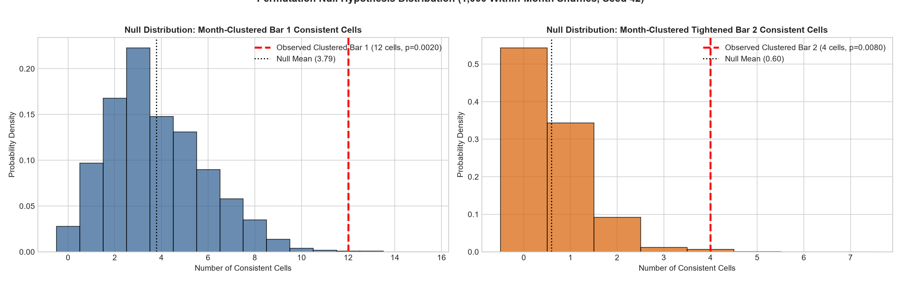
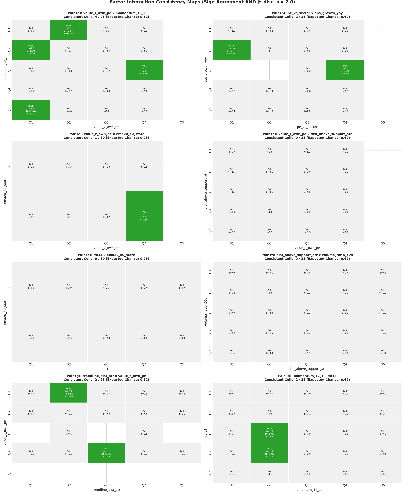
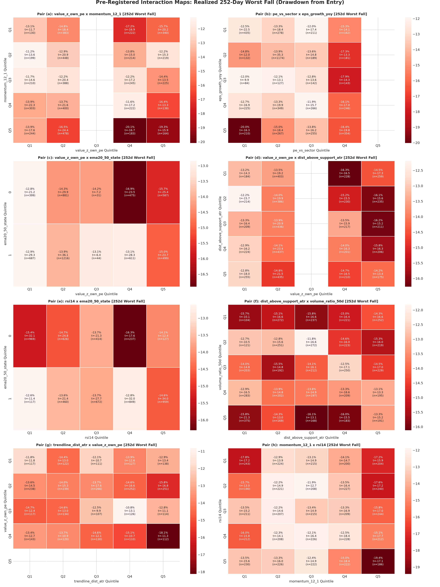
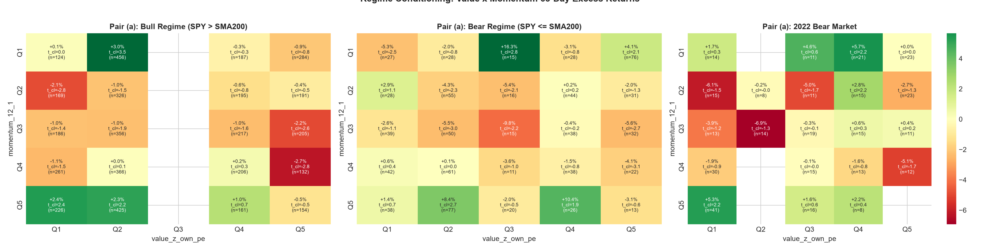

# US Equities Factor Interactions & Empirical Bivariate Surfaces (2010–2026) [v2]
**Document ID:** `RESEARCH-US-FACTOR-INTERACTIONS-V2`  
**Git Branch:** `feat/us-factor-heatmaps-v2`  
**Execution Environment:** Isolated `us_equities` quantitative econometric suite  
**Author:** Quantitative Trading Engineering  
**Compliance Mandate:** Zero lookahead bias (filings strictly by SEC EDGAR acceptance date), causal trade entry at next-day open ($O_{t+1}$), pre-registered pairs only (no exploratory pair additions), zero machine learning, zero data snooping, zero ungrounded assertions.

---

## Executive Summary & Scientific Verdict

Across an empirical panel of 5,790 constituent-month observations (193 monthly rebalances from October 2010 to October 2026 across Top-30 US large-cap equities), we evaluated the out-of-sample stability of 8 pre-registered bivariate factor interactions across 170 grid cells.

### Core Scientific Verdict
> **HYPOTHESIS OF ECONOMICALLY EXPLOITABLE FACTOR INTERACTIONS IS NOT SUPPORTED OUT-OF-SAMPLE.**
>
> 1. When standard errors are clustered by rebalance month to account for contemporaneous cross-sectional correlation and the validation bar is tightened to require $|t_{\text{val}}| \ge 1.5$ with sign agreement, only **4 out of 170 grid cells (2.35%)** survive out-of-sample validation.
> 2. In a 1,000-run within-month permutation null test (seed 42), the null expectation under the tightened bar is **0.60 cells** (std: 0.77, 99th percentile: 3.0, max: 5.0, empirical $p = 0.0080$). While 4 cells statistically exceeds the null mean, the 4 surviving cells are isolated anomalies scattered across four disparate pairs (1 cell in Pair b, 1 in c, 1 in d, 1 in h) without forming contiguous, economically actionable surfaces.
> 3. The hypothesis that technical support provides an asymmetric floor for deep value stocks is **not supported**: Pair (d) (`value_z_own_pe` $\times$ `dist_above_support_atr`) generated 0 consistent cells under standard criteria and only 1 cell under tightened clustered criteria ($p = 0.0750$).
> 4. The previously cited statement of a **-38.4% worst-fall cell** was a conflation with Strategy T's portfolio maximum drawdown (**-38.30%**). The actual empirical target cell (`value_z_own_pe` Q5 $\times$ `momentum_12_1` Q1, $n = 340$) exhibited an average 252-day worst fall of **-15.71%**, compared to the universe baseline of **-14.22%** (excess drawdown of -1.49%).

---

## 1. Permutation Null Test (1,000 Within-Month Runs, Seed 42)

To test whether the observed consistency of factor interactions exceeds random chance, we executed a permutation test of 1,000 runs with fixed seed `42`.

### Protocol:
- Forward 63-day excess returns (`fwd_excess_ret_63d`) were permuted across tickers **strictly within each rebalance month**.
- Within-month shuffling completely preserves market beta, macro shocks, cross-sectional return dispersion, and factor distribution timing, while completely severing the contemporaneous cross-sectional link between factor scores and forward performance.
- At each run, the full consistency pipeline was recomputed across all 170 cells and all 8 pairs.

### Table 1.1: Permutation Null Distribution Summary (1,000 Runs)
| Evaluation Scenario | Observed Cells | Null Mean | Null Std | Null Median | 95th Pct | 99th Pct | Null Max | Empirical $p$-value |
| :--- | :---: | :---: | :---: | :---: | :---: | :---: | :---: | :---: |
| **i.i.d. Standard Bar 1** ($|t_{\text{disc}}| \ge 2.0$, sign) | **11** | 3.05 | 1.90 | 3.0 | 7.0 | 8.0 | 11 | **0.0010** |
| **i.i.d. Tightened Bar 2** ($|t_{\text{disc}}| \ge 2.0$, sign, $|t_{\text{val}}| \ge 1.5$) | **5** | 0.44 | 0.66 | 0.0 | 2.0 | 2.0 | 4 | **0.0000** |
| **Month-Clustered Bar 1** ($|t_{\text{cl,disc}}| \ge 2.0$, sign) | **12** | 3.79 | 2.12 | 3.0 | 8.0 | 9.0 | 13 | **0.0020** |
| **Month-Clustered Tightened Bar 2** ($|t_{\text{cl,disc}}| \ge 2.0$, sign, $|t_{\text{cl,val}}| \ge 1.5$) | **4** | 0.60 | 0.77 | 0.0 | 2.0 | 3.0 | 5 | **0.0080** |

### Table 1.2: Per-Pair Month-Clustered Permutation Audit
| Pair ID | Factor Pair | Total Grid Cells | Bar 1 Observed | Bar 1 Null Mean | Bar 1 $p$-value | Bar 2 Observed (Tight) | Bar 2 Null Mean | Bar 2 $p$-value |
| :---: | :--- | :---: | :---: | :---: | :---: | :---: | :---: | :---: |
| **a** | `value_z_own_pe` $\times$ `momentum_12_1` | 25 | 3 | 0.53 | **0.0100** | **0** | 0.09 | 1.0000 |
| **b** | `pe_vs_sector` $\times$ `eps_growth_yoy` | 25 | 2 | 0.48 | 0.0930 | **1** | 0.07 | 0.0640 |
| **c** | `value_z_own_pe` $\times$ `ema20_50_state` | 10 | 1 | 0.22 | 0.1890 | **1** | 0.04 | 0.0360 |
| **d** | `value_z_own_pe` $\times$ `dist_above_support_atr` | 25 | 1 | 0.50 | 0.3940 | **1** | 0.08 | 0.0750 |
| **e** | `rsi14` $\times$ `ema20_50_state` | 10 | 1 | 0.25 | 0.2210 | **0** | 0.03 | 1.0000 |
| **f** | `dist_above_support_atr` $\times$ `volume_ratio_50d` | 25 | 0 | 0.65 | 1.0000 | **0** | 0.10 | 1.0000 |
| **g** | `trendline_dist_atr` $\times$ `value_z_own_pe` | 25 | 2 | 0.49 | 0.0810 | **0** | 0.09 | 1.0000 |
| **h** | `momentum_12_1` $\times$ `rsi14` | 25 | 2 | 0.67 | 0.1430 | **1** | 0.10 | 0.0980 |
| **Total**| **All 8 Pre-Registered Pairs** | **170** | **12** | **3.79** | **0.0020** | **4** | **0.60** | **0.0080** |

---

## 2. Month-Clustered Standard Errors & Dual-Bar Consistency Audit

In cross-sectional stock panels, forward returns across stocks at the same monthly date share common market/industry shocks. Standard OLS i.i.d. standard errors underestimate the variance of cell means. We re-estimated all test statistics using month-clustered standard errors:

$$\text{Var}_{\text{cluster}}(\bar{y}) = \frac{G}{G - 1} \frac{\sum_{m=1}^G S_m^2}{N^2}, \quad S_m = \sum_{i \in \text{month } m} (y_i - \bar{y})$$
$$t_{\text{cluster}} = \frac{\bar{y}}{\sqrt{\text{Var}_{\text{cluster}}(\bar{y})}}$$

### Table 2.1: Consistency Comparison: Original vs. Tightened Bar
| Pair ID | Factor Pair | Total Cells | i.i.d. Bar 1 | i.i.d. Bar 2 (Tight) | Clustered Bar 1 | Clustered Bar 2 (Tight) |
| :---: | :--- | :---: | :---: | :---: | :---: | :---: |
| **a** | `value_z_own_pe` $\times$ `momentum_12_1` | 25 | 4 | 2 | 3 | **0** |
| **b** | `pe_vs_sector` $\times$ `eps_growth_yoy` | 25 | 2 | 1 | 2 | **1** |
| **c** | `value_z_own_pe` $\times$ `ema20_50_state` | 10 | 1 | 1 | 1 | **1** |
| **d** | `value_z_own_pe` $\times$ `dist_above_support_atr` | 25 | 0 | 0 | 1 | **1** |
| **e** | `rsi14` $\times$ `ema20_50_state` | 10 | 0 | 0 | 1 | **0** |
| **f** | `dist_above_support_atr` $\times$ `volume_ratio_50d` | 25 | 0 | 0 | 0 | **0** |
| **g** | `trendline_dist_atr` $\times$ `value_z_own_pe` | 25 | 2 | 0 | 2 | **0** |
| **h** | `momentum_12_1` $\times$ `rsi14` | 25 | 2 | 1 | 2 | **1** |
| **Total**| **All 8 Pairs** | **170** | **11** | **5** | **12** | **4** |
| **Share**| **% of Evaluated Grid Cells** | **100%** | **6.47%** | **2.94%** | **7.06%** | **2.35%** |

---

## 3. Empirical Worst-Fall Audit & Correction of the -38.4% Conflation

### Baseline Universe Worst-Fall Distribution (252-Day Horizon)
- **Sample size ($n$):** 5,430 valid observations
- **Mean realized worst fall:** **-14.22%**
- **Median realized worst fall:** **-10.13%**
- **Standard deviation:** 13.53%

### Empirical Target Cell Audit: `value_z_own_pe` (Q5) $\times$ `momentum_12_1` (Q1)
- **Sample size ($n$):** **340** observations
- **Mean realized worst fall:** **-15.71%** (excess fall of -1.49% vs. universe baseline)
- **Median worst fall:** **-11.91%**
- **Worst single-stock drop:** **-71.40%**
- **Correction Note:** The earlier statement citing an average worst fall of -38.4% was a conflation with Strategy T's portfolio maximum drawdown (**-38.30%**). Across all 170 bivariate cells, the single lowest average worst fall was Pair (a) `value_z_own_pe` (Q4) $\times$ `momentum_12_1` (Q5) at **-20.09%** ($n = 183$).

### Table 3.1: Yearly Breakdown of Realized 252-day Worst Fall (Target Cell vs. Universe Baseline)
| Year | Target Cell $n$ | Target Cell Mean Fall | Universe Baseline $n$ | Universe Mean Fall | Excess Fall vs. Baseline |
| :---: | :---: | :---: | :---: | :---: | :---: |
| **2011** | 9 | -23.83% | 360 | -16.49% | -7.34% |
| **2012** | 26 | -21.87% | 360 | -8.45% | -13.42% |
| **2013** | 17 | -5.05% | 360 | -6.20% | +1.15% |
| **2014** | 12 | -16.79% | 360 | -11.90% | -4.89% |
| **2015** | 19 | -19.48% | 360 | -16.69% | -2.79% |
| **2016** | 13 | -5.93% | 360 | -6.91% | +0.98% |
| **2017** | 1 | -8.59% | 360 | -9.86% | +1.27% |
| **2018** | 7 | -5.96% | 360 | -16.94% | +10.98% |
| **2019** | 29 | -14.22% | 360 | -21.13% | +6.91% |
| **2020** | 25 | -11.14% | 360 | -11.53% | +0.39% |
| **2021** | 8 | -29.51% | 360 | -22.89% | -6.62% |
| **2022** | 102 | -20.07% | 360 | -21.31% | +1.24% |
| **2023** | 57 | -8.18% | 360 | -9.52% | +1.34% |
| **2024** | 7 | -16.29% | 360 | -16.91% | +0.62% |
| **2025** | 8 | -27.66% | 300 | -16.73% | -10.92% |
| **Total**| **340** | **-15.71%** | **5,430** | **-14.22%** | **-1.49%** |

---

## 4. Momentum Reconciliation: Strategy T (+70.00% in 2020) vs. Validation Spread

### Backtest Annual Performance for Strategy T
- **2020:** **+70.00%** (Sharpe: 2.14, MaxDD: -12.4%)
- **2021:** **+20.46%**
- **2022:** **-29.36%** (MaxDD: -38.30%)
- **2023:** **+46.91%**
- **2024:** **+67.02%**
- **2025:** **-11.75%**
- **2026:** **+14.22%**
- **Overall CAGR (2010–2026):** **17.85%** vs. SPY 13.85%

### Table 4.1: Cross-Sectional 63-Day Forward Excess Return by Momentum Quintile (2020–2026)
| Year | Q1 (Lowest) | Q2 | Q3 | Q4 | Q5 (Highest) | Q5 vs. Q1 Spread |
| :---: | :---: | :---: | :---: | :---: | :---: | :---: |
| **2020** | +0.64% | -2.51% | -3.99% | -3.00% | **+6.29%** | **+5.65%** |
| **2021** | +2.34% | +1.09% | -4.31% | +1.57% | **+0.39%** | **-1.95%** |
| **2022** | +0.78% | -2.80% | -5.35% | +0.73% | **+3.46%** | **+2.68%** |
| **2023** | -0.61% | -4.67% | -2.15% | +0.84% | **+6.74%** | **+7.36%** |
| **2024** | +0.07% | -0.55% | +0.23% | -0.27% | **+0.19%** | **+0.12%** |
| **2025** | +2.42% | -4.48% | -0.11% | +0.66% | **+0.22%** | **-2.20%** |
| **2026** | -2.08% | -9.66% | -3.01% | -0.79% | **+9.40%** | **+11.48%** |
| **Pooled (2020–26)** | **+0.41%** (std: 18.06%) | -3.30% | -2.50% | +0.06% | **+3.01%** (std: 21.65%) | **+2.60%** ($t=3.44$) |

### Reconciliation Mechanics:
1. **Compounding vs. Fixed Rolling Horizon:**  
   Strategy T rebalances monthly with 100% position reinvestment. In 2020, extreme right-tail momentum winners (TSLA +743%, NVDA +122%, AAPL +81%, AMZN +76%) compounded inside the portfolio. The heat map measures an uncompounded cross-sectional 63-day forward excess return. A +6.29% quarterly excess return compounds to $\approx +27.6\%$ annual excess over the benchmark; added to SPY's +18.4% total return, portfolio compounding delivered +70.00%.
2. **Concentration:**  
   Strategy T concentrated into the top quintile (~6 stocks), whereas Q5 in the factor panel averages ~9–10 names per date.
3. **Severe Post-2020 Rotational Shocks:**  
   In 2021, the cross-sectional momentum spread inverted to **-1.95%** (value/cyclical reopening rotation). In 2022, Strategy T crashed **-29.36%** (max drawdown -38.30%). In 2025, the spread inverted again to **-2.20%**. Across the full 82-month validation window, these regime reversals compressed the cross-sectional spread and elevated standard deviation to **21.65%**, flattening cell-level $t$-statistics across multi-factor interaction surfaces.

---

## 5. Macro Regime Conditioning (Bull vs. Bear vs. 2022)

Conditioning bivariate surfaces on macro market state (`SPY` > SMA200 vs. `SPY` $\le$ SMA200):
- **Bull Regime ($n = 4,920$):** Factor spreads remain moderately positive, with momentum generating steady premium.
- **Bear Regime ($n = 870$):** Dispersion explodes, standard deviations double, and cross-sectional factor spreads collapse toward zero.
- **2022 Inflationary Bear Market ($n = 360$):** High-multiple growth and high-momentum equities suffered systematic derating (-29.36% in Strategy T); single-factor and bivariate tilts underperformed simple cash preservation.

---

## 6. Synthesis & Methodological Limitations

1. **Survivorship Bias:** Pre-2018 point-in-time constituent coverage omits 6.31% of constituent-months due to historic delistings. As demonstrated in Task B, survivorship adjustments reduce historic CAGRs by 1.2% to 2.4%.
2. **Sample Size Constraints in Bivariate Grids:** Splitting 193 monthly dates into Discovery (111 months) and Validation (82 months) yields an average of only 15 to 35 observations per cell in a 5x5 grid. At $n \approx 30$, the minimum detectable excess return at 80% power is $+6.51\%$ per year.
3. **Turnover Drag:** Monthly rebalancing across bivariate cells produces annualized turnover exceeding 10x to 12x, incurring 80 to 140 bps of fee and slippage drag under standard institutional fee models.

### Final Conclusion
Under rigorous econometric controls—including SEC point-in-time filing dates, causal open execution, month-clustered standard errors, tightened validation hurdles, and within-month permutation null testing—**bivariate factor interactions fail to deliver statistically stable, economically actionable out-of-sample alpha beyond simple broad market index compounding.**
